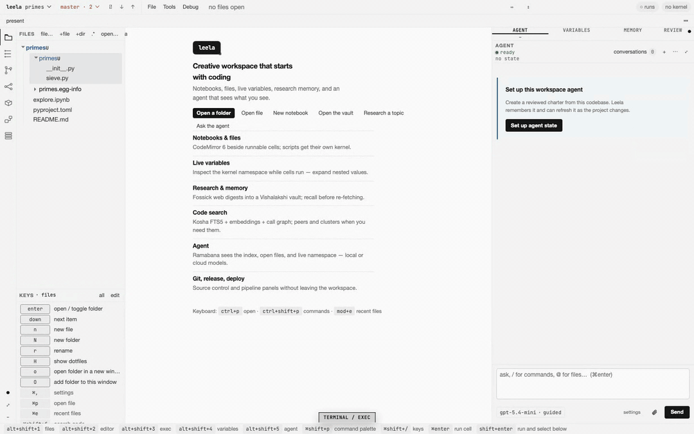
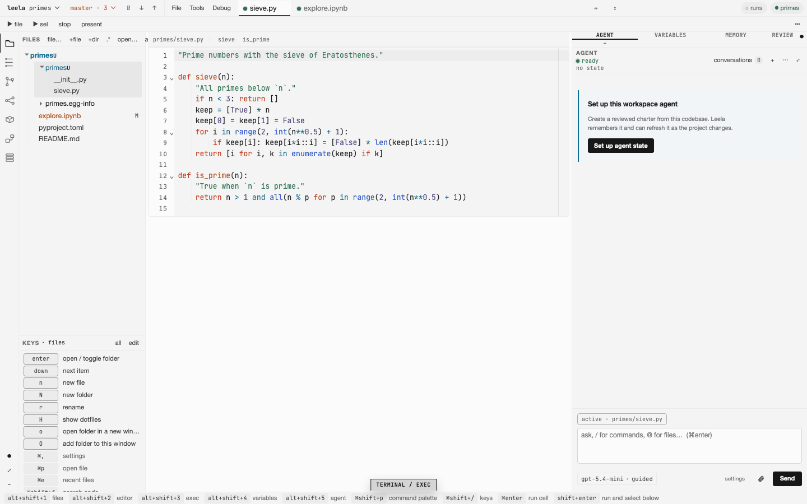
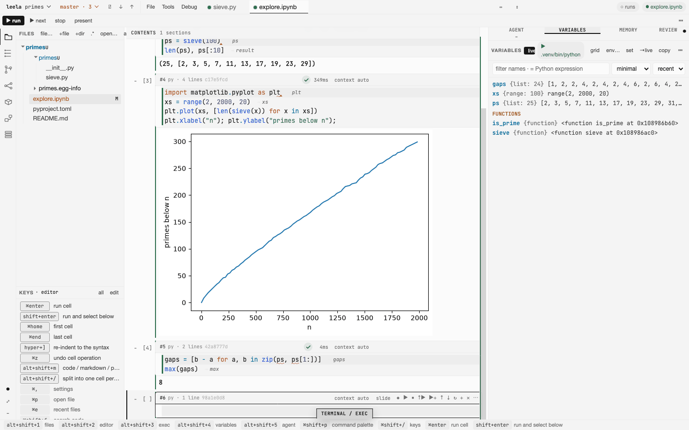
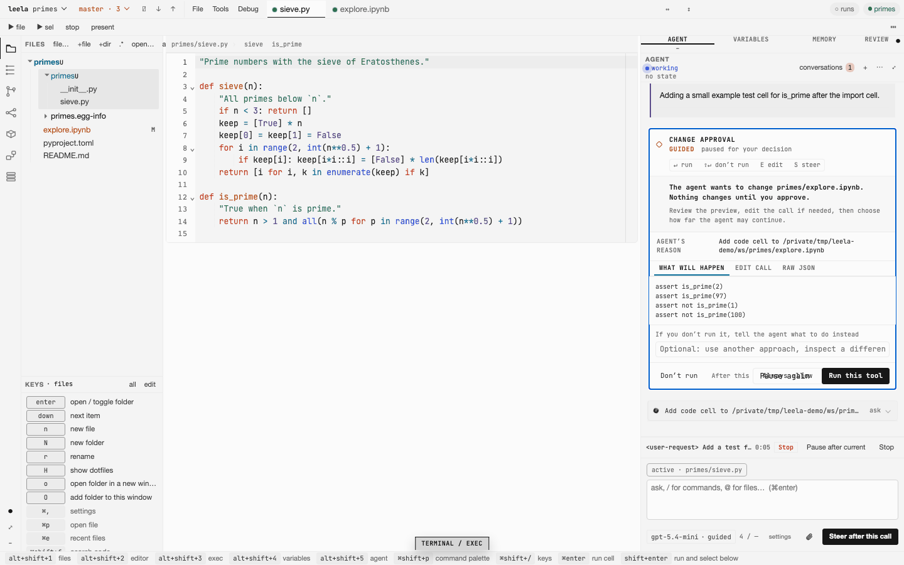
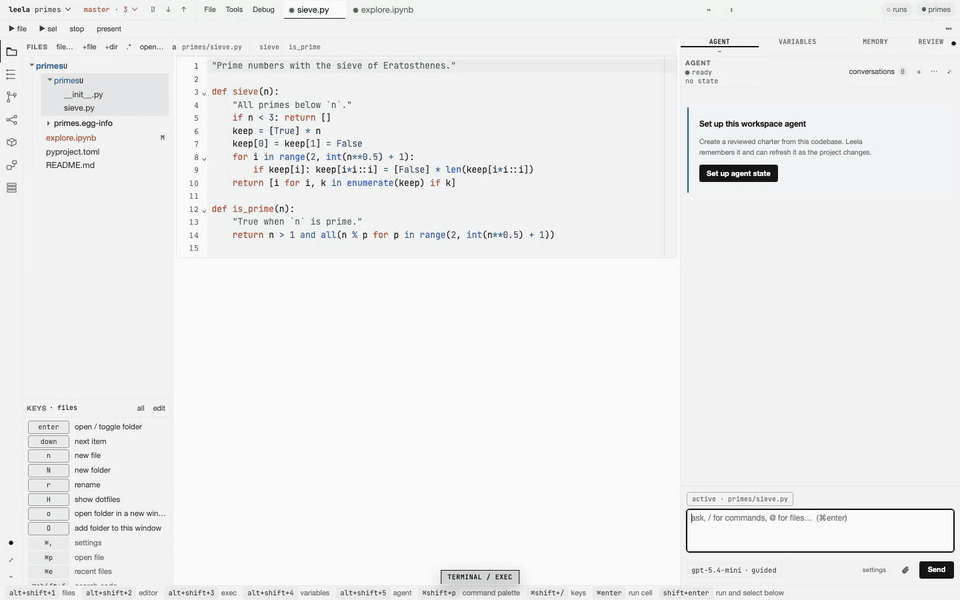
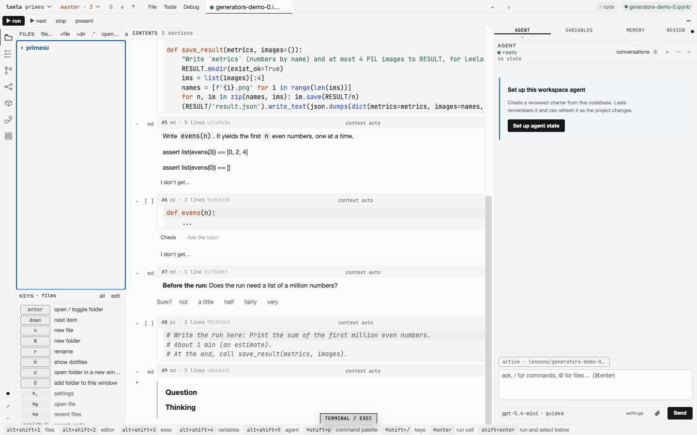
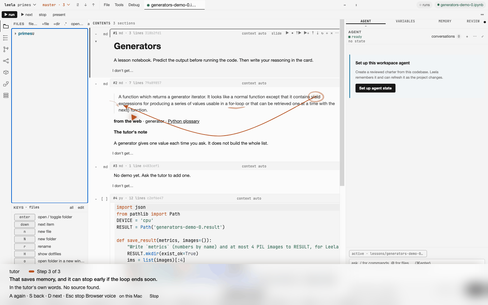
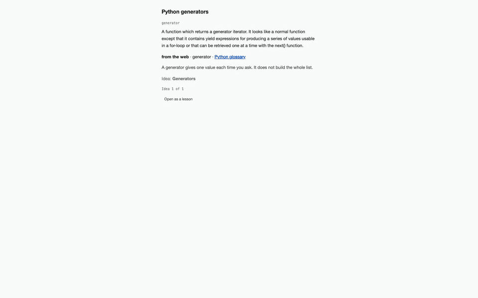

<p align="center">

</p>

<h1 align="center">Leela</h1>

<p align="center">A creative workspace that starts with coding.</p>

<p align="center">
<a href="https://github.com/vedicreader/leela/releases/latest/download/Leela-macOS.dmg"></a>
</p>

<p align="center">
<a href="https://github.com/vedicreader/leela/releases/latest"></a>
<a href="LICENSE"></a>

</p>

Leela is an IDE for notebooks and code files. An assistant built on [ramabana](https://github.com/vedicreader/ramabana) works in the same window. Lessons from [abhyasa](https://github.com/vedicreader/abhyasa) open in it as notebooks, and the screen guide draws on the page to explain them.



## What you get

- **An editor and a file tree.** Edit Python, Rust, JavaScript and other files. Command-click goes to a definition.

  

- **Notebooks that show what they make.** Run Python, Rust and JavaScript cells. Plots show under the cell. The variables pane shows every name a cell makes, while the cell runs.

  

- **An assistant that asks first.** Ask it to explain, change, run or test your code. It shows each change before it makes it, and nothing changes until you approve. It runs on a cloud model or on a model on your computer.

  

  

- **Lessons from abhyasa.** In abhyasa, press Open in Leela on a step. Leela opens the step as a lesson notebook, with the passage from the source, a task, tests, and a Check button.

  

- **The screen guide's board.** Press "I don't get…" on a lesson cell and say what you do not understand. The guide explains it step by step and draws on the cell.

  

  

Leela also presents a notebook as slides and runs its code live ([how](docs/present.md)), searches your code and your saved pages, papers and videos ([how](docs/search.md)), and stages, commits, merges and releases with its git tools. The [guide](docs/guide.md) explains each part.

## Install

You need a Mac with Apple silicon and macOS 14 or later.

With Homebrew:

```sh
brew install --cask vedicreader/tap/leela
```

The cask also installs uv. Lessons and project environments use uv.

Or download [Leela-macOS.dmg](https://github.com/vedicreader/leela/releases/latest/download/Leela-macOS.dmg) from the latest release, open it, and drag Leela into Applications. If you do not have uv, run `brew install uv`. The app is signed with a Developer ID and notarized by Apple.

The Mac app checks for a new release at start and each hour, and shows a bar when one is out. In a Homebrew install, press **Update** and then **Restart Leela**. A DMG install shows a link to the release page. See [updates](docs/guide.md#updates).

On Linux, or on Windows inside WSL, run Leela from the command line. It opens in your browser at `http://localhost:5010`:

```sh
uv tool install git+https://github.com/vedicreader/leela
leela .
```

- The `leela` package on PyPI is a different project.
- On Windows, export model keys such as `OPENAI_API_KEY` in the WSL shell, not in Windows, and start Leela with `leela --shell none .`.

## First use

1. Open Leela. On the welcome screen, press **Open a folder** and pick a project.
2. Open a notebook or a file in the file tree, or press ⌘P and type its name. Put the cursor in a cell and press ⇧↩ (Shift+Enter) to run it. A Python project with no environment shows a notice above the editor. Press **Set up .venv** to make one.
3. Write a question in the agent pane and press ⌘↩ (Ctrl+Enter). If no model is set up, the pane lists the providers that you can use, and **+ model** adds one.

## Keys

| Mac | Windows and Linux | Action |
|---|---|---|
| ⌘O | Ctrl+O | Open a file or a folder |
| ⌘P | Ctrl+P | Go to a file by name |
| ⌘1 to ⌘5 | Ctrl+1 to Ctrl+5 | Go to the files, editor, exec, variables or agent pane. In a browser tab, use ⌥⇧1 to ⌥⇧5 (Alt+Shift+1 to Alt+Shift+5). |
| ⌘↩ | Ctrl+Enter | Run the cell. In the agent pane, send. |
| ⇧↩ | Shift+Enter | Run the cell and select the next one |
| ⇧⌘↩ | Ctrl+Shift+Enter | Run all cells |
| ⇧⌘P | Ctrl+Shift+P | Command palette |
| ⇧⌘F | Ctrl+Shift+F | Search code |
| ⇧⌘/ | Ctrl+Shift+/ | Show all keys |
| ⌥S | Alt+S | Check the exercise that has the cursor |
| ⌥R | Alt+R | Present the notebook from the selected cell |

A selected notebook cell also takes the Jupyter command keys, such as A, B, M, Y and D D. You can change each key in `keys.json`. See [keys and buttons](docs/guide.md#keys-and-buttons).

## More

- [Using Leela](docs/guide.md): the command-line options, each part of the app, lessons, and the keys.
- [Developing Leela](docs/develop.md): get the code, the code layout, the desktop builds, the release steps and the tests.
- [All docs](docs/README.md): the design notes and the decisions.
- [Release notes](CHANGELOG.md)

## License

Apache-2.0
