<p align="center">
  
</p>

# leela

<p align="center"><em>creative workspace that starts with coding</em></p>

A browser IDE for notebooks, files, live variables, research memory, and an agent —
same shell as a native desktop window.

<video src="docs/media/leela-showcase.mp4" controls width="100%" poster="docs/screenshots/web-showcase-poster.png"></video>

<p align="center"><a href="docs/media/leela-showcase.mp4">Watch the walkthrough</a> · editor → agent turn → variables → git → palette → search</p>

## Install

```sh
pip install leela                # base
pip install "leela[github]"      # workflows, releases, deploys
pip install "leela[gateway]"     # jupygate kernel transport
```

## Use

```sh
leela                      # the saved workspace
leela .                    # a folder
leela src tests            # one workspace, two roots
leela --app src tests      # app windows in fossick's persistent CDP Chrome
leela --shell webview .    # native desktop window
```

`--app` picks the workspace shape. `--shell` picks what opens on top: `chrome`, `webview`, or `none`.
`leela --help` for transport, kernel, agent, and keymap flags.

## The IDE

### Notebooks and files, side by side

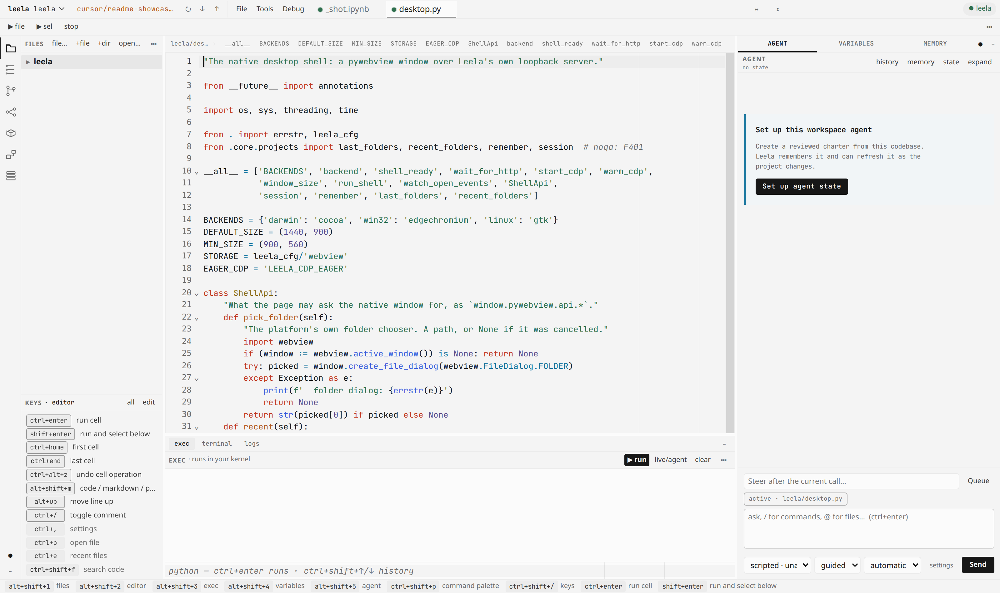

CodeMirror 6 for notebooks and text. A `.py` file runs as a script in the tab's own kernel.
`▶ file` / `▶ sel`, `mod+e` for recent tabs, atomic autosave.

### An agent that leaves a trail

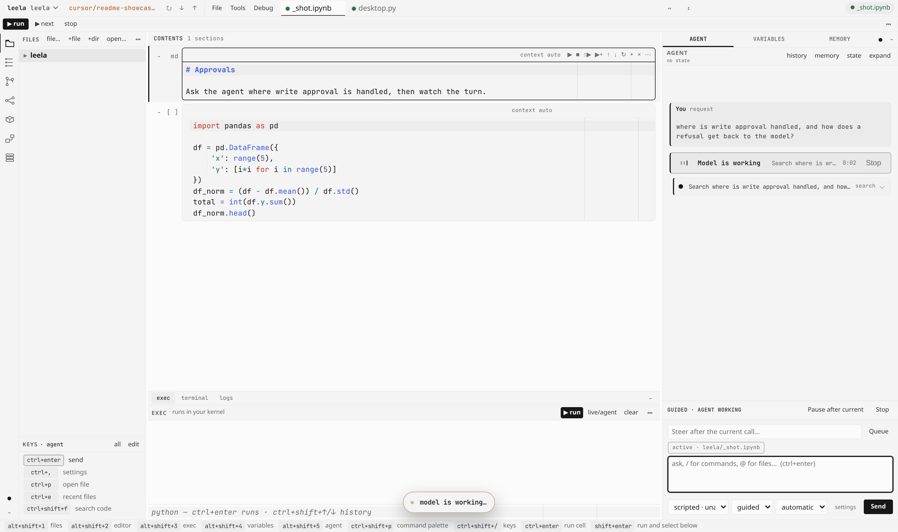

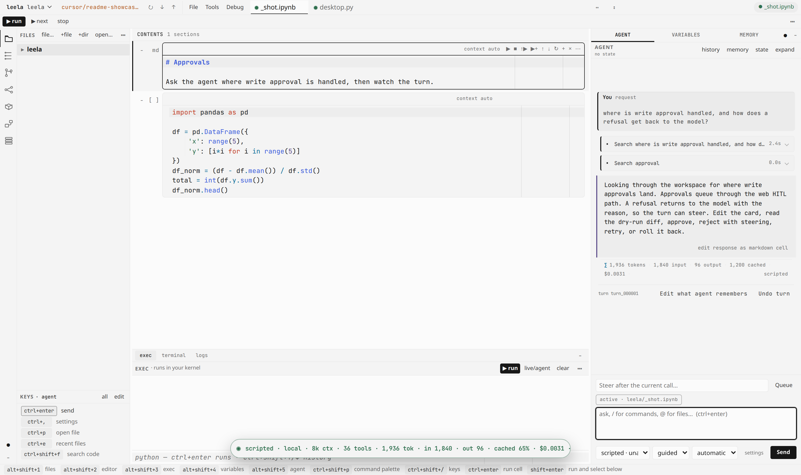

Every call is a lifecycle card: edit it, read the dry-run diff, approve, reject with steering,
retry, or roll it back. Autopilot / guided / directed decide how much of that you see.
Harness: [ramabana](https://github.com/vedicreader/ramabana) (`leela.agent` is an alias).

### Live variables

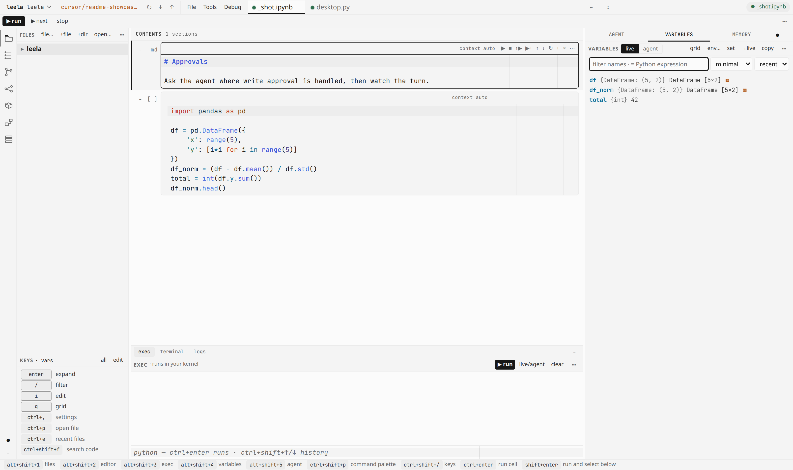

Each tab owns a real kernel with a [dhrishti](https://github.com/vedicreader/dhrishti) inspector
inside it. Prefix the filter with `=` to evaluate against the watched runtime.

### Source control

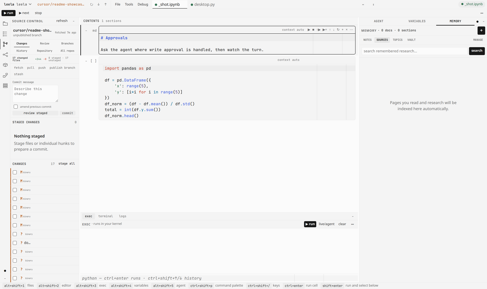

Changes, Review, Branches, History, Repository, All repos. Diffs as editor tabs; blame reads
notebooks as cells. `leela ~/code` answers which checkouts are dirty, behind, or unpublished.

### Search and memory

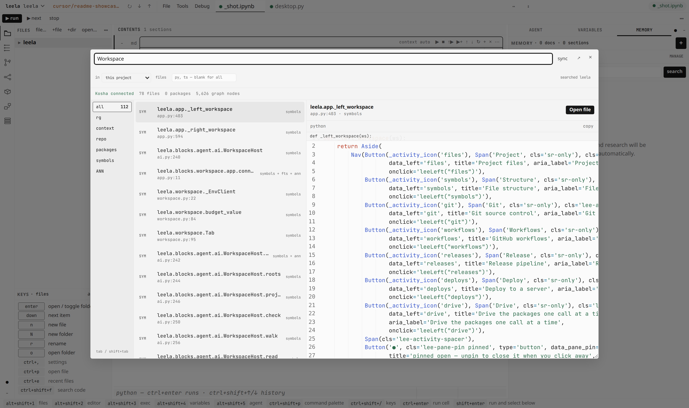

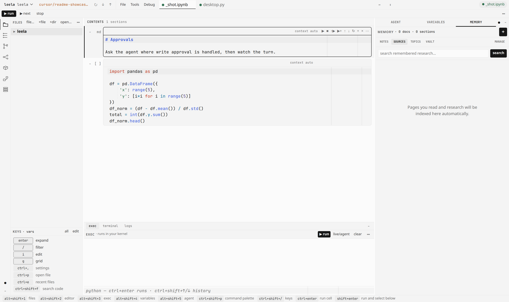

[koshas](https://pypi.org/project/koshas/) for code (FTS5, embeddings, call graph) behind
`mod+shift+f`. [vishalakshi](https://github.com/vedicreader/vishalakshi) vault for prose —
pages read and research sources, recalled instead of re-fetched.

### Command palette

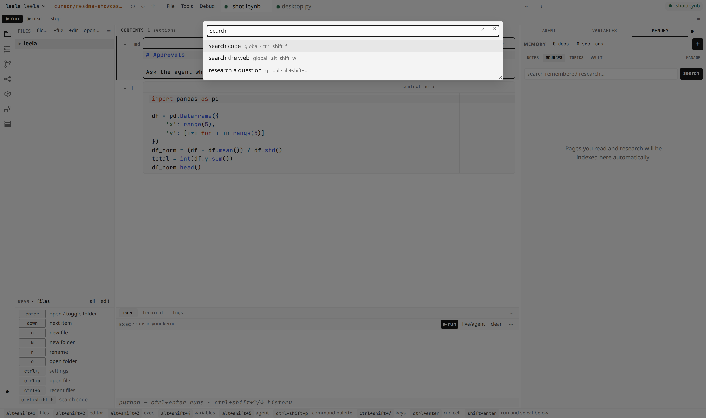

Every action has a button, a palette entry (`mod+shift+p`), and a rebindable chord.
Keys: [docs/desktop.md](docs/desktop.md) and `leela --write-keymap`.

### Desktop app

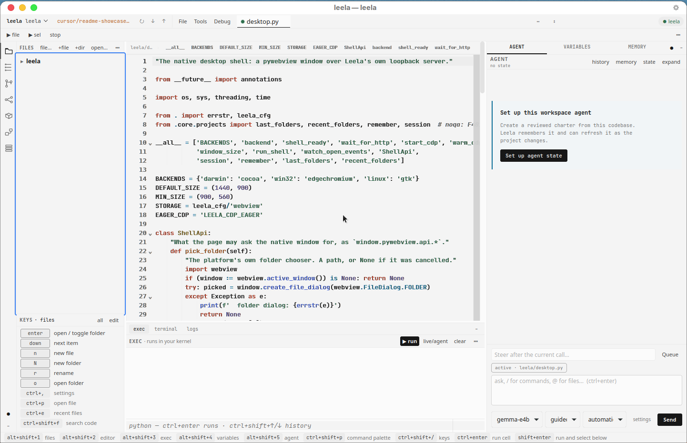

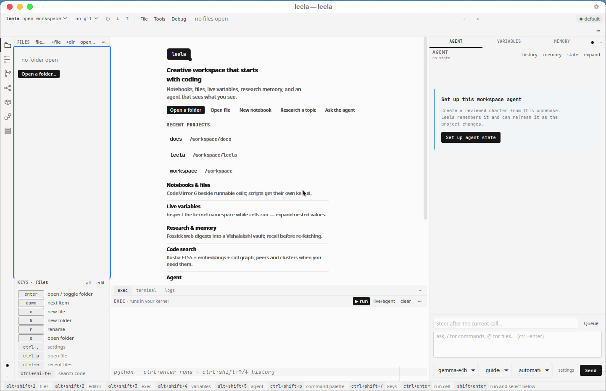

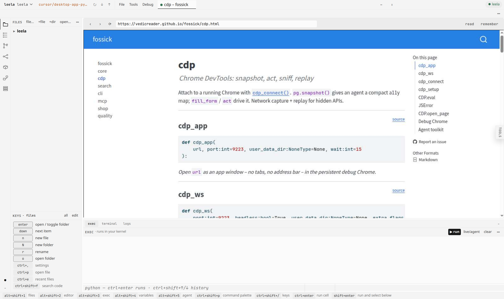

Native window over the same loopback server. Chrome for the inline browser starts when a page
needs it, not at launch. Packaging and rationale: [docs/desktop.md](docs/desktop.md).

```sh
uv sync --extra desktop
leela --shell webview .
```

### Watching a process

```json
{"runs": [
  {"name": "api", "cmd": "uvicorn app:app --port 8000", "watch": "app"}
]}
```

A process leela started under a run configuration is watchable. Anything else joins with:

```python
import dhrishti.serving as ds; ds.serve(name='api')
```

## Develop

```sh
uv venv --python 3.12
uv pip install -e . --group test
pytest tests -q
python tools/showcase.py          # refresh README stills + docs/media/leela-showcase.mp4
python tools/webshots.py          # agent-stream stills only
python tools/deskshots.py         # native window stills
```

Layout and block contract: [docs/blocks.md](docs/blocks.md).
What belongs in a dependency: [docs/integration.md](docs/integration.md).

## License

Apache-2.0
