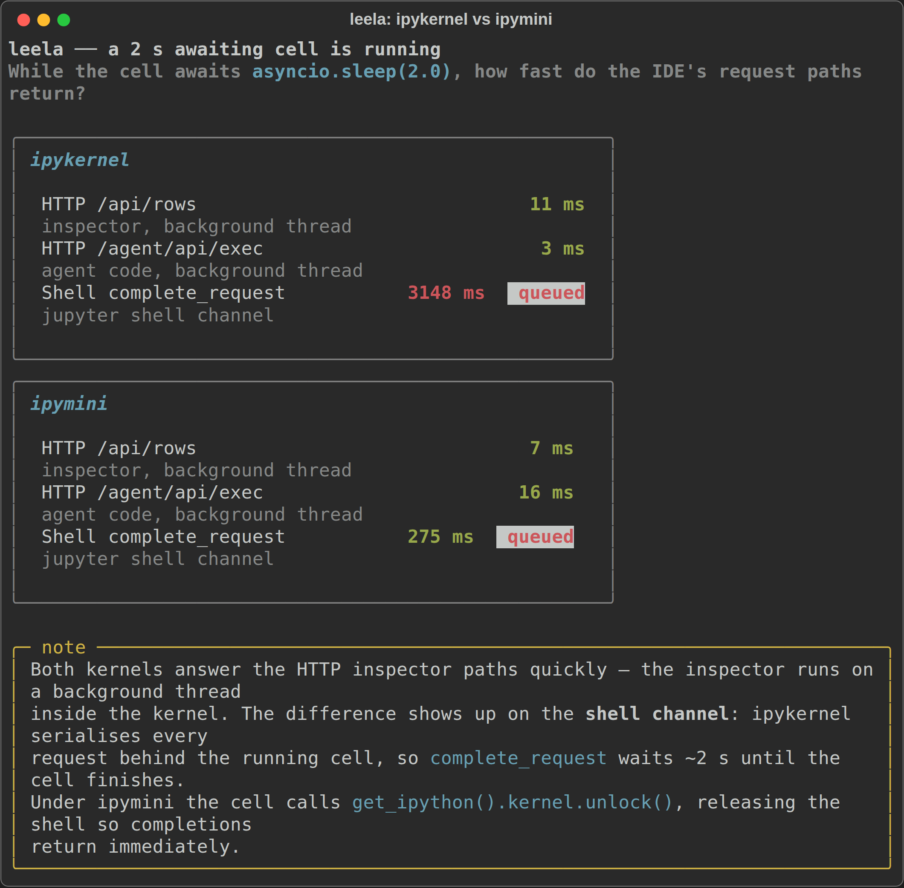

# leela

> creative workspace that starts with coding

leela is an IDE for notebooks, files and **live variables** — in the terminal or in
the browser, over the same workspace. It grew up inside
[dhrishti](https://github.com/vedicreader/dhrishti) and now stands on its own, with
no dependency back.

It comes in two halves. `leela.inspect` is the engine: it turns a live Python
namespace into the node tree the frontends render, runs code in it, and serves that
over HTTP from *inside* the kernel that owns it. Everything else is the application
shell — the workspace, the notebook document, the assistant, and the two frontends.

## Install

```sh
pip install leela
```

## Use

```sh
leela                      # open the saved workspace in the terminal
leela .                    # open a folder in the terminal
leela --web src tests      # open two folders in the browser
```

Both frontends drive one `Workspace`, so the terminal and the browser show the same
folders, tabs and kernels.

## What it does

- **Notebooks and files** side by side, with a real editor in each frontend
  (Textual in the terminal, CodeMirror 6 in the browser).
- **Live variables** from the notebook's own kernel. Each notebook tab owns a real
  ipykernel process with an inspector running *inside* it, so the variable tree
  stays responsive even while a long cell is running.
- **Concurrent kernels (optional).** Pass `--kernel ipymini` to launch each notebook
  under [ipymini](https://github.com/AnswerDotAI/ipymini) instead of ipykernel.
  ipymini exposes `get_ipython().kernel.unlock()` and `.subshell()` so leela's
  in-kernel inspector and agent execs don't queue behind a long-running cell.
  Install with `pip install "leela[ipymini]"`; it falls back to ipykernel with a
  warning if the extra isn't installed.

  Measured on a cell that awaits `asyncio.sleep(2.0)`:

  

  The HTTP inspector paths already ran on a background thread, so they answer
  quickly on both kernels. The shell channel is where ipymini matters &mdash; a
  `complete_request` (used by the completion popup) waits ~3&thinsp;s behind the
  cell on ipykernel and returns in ~275&thinsp;ms on ipymini.

  
- **Shared kernels per folder.** Tabs bind per root, not per tab: the exec strip,
  the scratch box and two open notebooks all see the same variables. A tab can opt
  out and take a private kernel.
- **Prompt cells.** Ask a question in the notebook and the answer is saved *in the
  cell* — re-runnable, read in order with everything else. Written as markdown with
  the reply in metadata, so the file stays valid and legible in plain Jupyter.
- **An agent** that sees what you see: the code index, the open files, the live
  namespace, and the IDE's own screen. It runs on a local model or a cloud one, and
  routes the cheap jobs — completions, summaries, sub-agent fan-out — to the local one
  whatever the turn is running on.
- **Approval as a conversation.** When the agent wants to write, it asks, shows you the
  edit, and takes your *reason* — which goes back to the model, so "no, that file is
  generated" redirects it instead of making it retry. The whole exchange is saved into
  the notebook as markdown cells.
- **A running account of what it is doing.** Every tool call shows up as it happens —
  `Search AgentSession`, `View leela/ai.py:240-290`, `Web fetch: …` — with the result one
  fold away, and the trail saved under the answer.
- **Skills from whatever is installed.** Packages that publish a `pyskills` entry point,
  plus `SKILL.md` directories. Installing `aidialog` teaches the agent to edit notebooks
  with no code on leela's side.
- **Code search** over [kosha](https://pypi.org/project/koshas/) — FTS5, embeddings
  and a call graph — falling back to a literal scan when the index is unavailable.
- **A dev server** that runs your app under a live inspector, so its module
  namespace shows up in the variable panel while it serves.
- **A terminal**, and lazygit if you have it.

## Layout

```
leela/
  inspect/        the engine: namespace -> node tree, and the in-kernel JSON API
    core.py       variable info, resolvers, snapshots, the grouped view
    runtime.py    executing and completing in a namespace; the Bridge
    agent.py      the agent overlay and its restriction list
    server.py     the HTTP API served from inside each kernel
  agent/          the harness: the brain, with no import back into the IDE
    host.py       what an application must supply to host an agent
    backend.py    one chat protocol over rishi (local) and fastllm (cloud)
    models.py     the model table, and which model each *job* runs on
    hitl.py       approval as a conversation, with the reason carried back
    compact.py    surviving a long conversation, and saying so afterwards
    skills.py     skills discovered from installed packages and SKILL.md dirs
    activity.py   the live account of what the agent is doing
    tools.py      the tools, written against `Host`
    extensions.py user Python that registers more of all of the above
    subagent.py   delegation to a cheap model whose context is thrown away
    chat.py       the facade the application holds
  cli.py          the `leela` entry point
  workspace.py    open folders, open tabs, and which kernel each tab talks to
  kernels.py      managed ipykernels, each hosting its own inspector
  nb.py           the notebook document: cells, outputs, running them
  ai.py           binds a `Workspace` to the harness; notebook-based approval
  search.py       code search over kosha, with a plain-scan fallback
  diffs.py        the diff engine both frontends render
  keys.py         single-source keymap for both frontends
  fs.py           filesystem access, confined to the open folders
  term.py         terminals and lazygit
  research.py     web search and fetch
  devserver.py    run an app under a live inspector
  tui/            the terminal frontend (Textual)
  web/            the browser frontend (FastHTML), with vendored browser bundles
```

`keys.py` is the single source of the keymap: the TUI builds its bindings from it
and the web client generates its handlers from it, so the two frontends cannot
drift apart on shortcuts.

## Develop

```sh
uv venv --python 3.12
uv pip install -e . --group test
pytest tests -q
```

The suite covers the inspection engine, the notebook document, the diff engine, the
keymap, the agent harness, and SVG snapshots of the terminal frontend. The harness tests
load no model: a `FakeBackend` over scripted replies drives a whole turn, which is enough
to test routing, approval, compaction and the tool wrappers without gigabytes in the way. Kernels are faked in
`tests/conftest.py` rather than launched, so the tests are fast and do not need a
working ipykernel — `tests/test_inspect.py` covers the engine directly instead, by
driving it over a plain dict.

The browser bundles in `leela/web/static` are committed so users never need node.
To rebuild them:

```sh
cd leela/web/src && npm install && npm run build
```

## License

Apache-2.0
