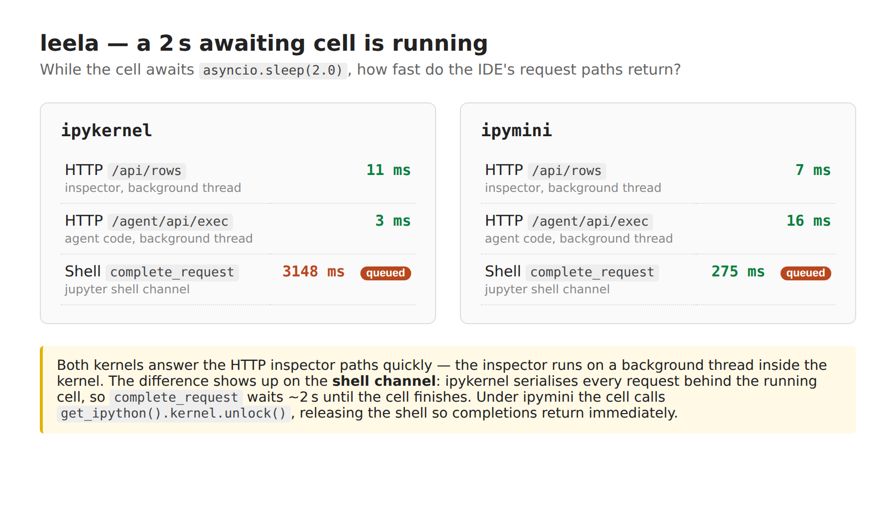

# leela

> creative workspace that starts with coding

leela is a browser IDE for notebooks, files and **live variables**. It grew up inside
[dhrishti](https://github.com/vedicreader/dhrishti), and depends on it again.

It comes in two halves. dhrishti is the engine: it turns a live Python namespace into the
node tree the browser renders, runs code in it, and serves that as a JSON API from *inside*
the kernel that owns it. Everything in this repository is the application shell — the
workspace, the notebook document, the assistant, and the web frontend.

## Install

```sh
pip install leela
```

## Use

```sh
leela                      # open the saved browser workspace
leela .                    # open a folder
leela src tests            # one browser workspace with two roots
leela --app src tests      # two independent app windows in the persistent CDP Chrome
```

Workflows, releases and their credentials need gheasy and dockeasy:

```sh
pip install "leela[github]"
```

`--app` uses `fossick.cdp.cdp_setup` on port 9223 and reuses its persistent Chrome
profile. Each folder gets an isolated `Workspace`, document store, agent, terminals, and
kernel pool at `folder.localhost:5001`; it does not start another resident Chrome per
folder. App mode uses the shared jupygate transport by default. Use `--transport direct`
to retain Leela's local ZMQ client, or `--transport gateway` in the browser workspace.
Install gateway support with `pip install "leela[gateway]"`.

Every browser workspace owns one `Workspace` containing its folders, tabs, and kernels.
The planned separation for independent windows, project sessions,
a runtime broker, and gateway-hosted kernels is documented in
[Multi-workspace and multi-window architecture](docs/multi-workspace-architecture.md).

The browser interaction model is documented in the [Browser workbench guide](docs/browser-workbench.md).

## What it does

- **Notebooks and files** side by side, with a CodeMirror 6 editor. A notebook runs its cells;
  a `.py` file runs as a *script* — `▶ file`, or `mod+alt+enter` — in the tab's
  own kernel, so it gets `__main__` and an argv, and everything it defines is in the
  variable panel when it finishes. `▶ sel` runs just what you have selected. Scripts
  start at the containing Git repository root by default; click the `cwd` pill in the
  browser to set a per-tab directory or return to automatic discovery.
- **Recent files by use, not tab position.** `mod+e` opens an MRU switcher with filtering,
  unsaved/running state and keyboard close. Browser-reserved `ctrl+tab` cannot be a reliable
  web binding, so the JetBrains-style recent-files gesture uses `mod+e`, while
  `alt+[` / `alt+]` still move positionally through the tab strip. The header
  keeps only the active tab and a bounded set of neighbours visible; the remaining tabs move
  into a `+N` overflow menu instead of squeezing the workspace, menus and kernel status away.
- **Research without leaving the workspace.** Search the web, read a URL through Fossick's
  clean Markdown extraction, or build a cited digest from several sources. The Research
  workspace keeps sources beside the reader and can open the original page, save Markdown,
  create a notebook, or carry the source list into the agent composer. Fetched and model
  Markdown cannot execute explicit raw-HTML fences; authored notebook Markdown can still use
  deliberate `{=html}` passthrough.
- **Durable research memory.** Every page Leela reads and every source in a research brief is
  ingested automatically into a persistent litesearch database. It reuses Kosha's resident
  embedder, but stores prose as document trees rather than mixing it into the AST-shaped code
  index. The Memory tab browses recent documents, heading trees, whole sections, hybrid
  FTS/ANN retrieval and labelled semantic clusters. The agent gets the same `memory_search`,
  `memory_tree`, `memory_read` and `memory_topics` tools, so an earlier investigation can be
  recalled before paying to search the live web again. Memory is controllable rather than an
  indiscriminate archive: turn off **remember** before a read/research run, forget the active
  source from its reader, purge selected bad results, or purge the complete corpus. Purging
  removes the document tree, chunks and ANN entries together.
- **Buttons for everything, and keys you can change.** Every action has a toolbar or
  panel button, a command-palette entry, and a chord you can rebind — see
  [keys and buttons](#keys-and-buttons). `hyper` means Command+Control+Option+Shift in
  the Mac browser, so a Caps Lock mapped to Hyper becomes a dense IDE command layer.
- **A kernel picker.** `kernel…` in the toolbar (or the kernel pill in the browser)
  lists the launchers and the interpreters it can find — the venv in your project as
  well as leela's own — and starts the tab's kernel on whichever you click.
- **Inline AI help for any selection.** Select code or prose in a file, notebook cell or
  Exec editor and a small local toolbar offers **summarise** or **ask AI**. Instructions run
  as a throwaway completion job; summaries use the configured summariser. The response is
  only a proposal beside the source — discard it, or replace the exact original selection.
  If the selection changed while the model was working, Leela refuses the replacement rather
  than applying stale output.
- **Expandable expression results wherever Python runs.** A trailing value from a notebook
  cell or the Exec strip opens in a floating value lens with the same lazy nested expansion
  as Variables — so `_hits[0]['path']` is inspectable without first assigning another name.
  The Variables filter remains a fast name filter; prefix it with `=` and press Enter to
  evaluate Python against the watched runtime and open its result in that same lens.
- **Live variables** from the notebook's own kernel. Each notebook tab owns a real
  ipykernel process with an inspector running *inside* it, so the variable tree
  stays responsive even while a long cell is running.
- **Concurrent kernels.** Pass `--kernel ipymini` to launch each notebook
  under [ipymini](https://github.com/AnswerDotAI/ipymini) instead of ipykernel.
  ipymini exposes `get_ipython().kernel.unlock()` and `.subshell()` so leela's
  in-kernel inspector and agent execs don't queue behind a long-running cell.
  Both ipykernel and ipymini ship with Leela. When a project interpreter is selected,
  the kernel picker can install both into that environment through uv without leaving the app.

  Measured on a cell that awaits `asyncio.sleep(2.0)`:

  

  The HTTP inspector paths already ran on a background thread, so they answer
  quickly on both kernels. The shell channel is where ipymini matters &mdash; a
  `complete_request` (used by the completion popup) waits ~3&thinsp;s behind the
  cell on ipykernel and returns in ~275&thinsp;ms on ipymini.

- **One kernel per notebook.** Notebook tabs are isolated from each other by default, so
  switching tabs switches Variables and Exec to that notebook's kernel. Source-file tabs
  share their folder kernel, and a notebook can explicitly attach to it from the kernel
  picker. Picking a watched app is temporary: changing tabs returns to the new tab's kernel.
- **Paste-safe structural Markdown.** Notebook Markdown, model replies and rich Markdown
  outputs all render through [mdhtml](https://github.com/AnswerDotAI/mdhtml), not a permissive
  browser parser. Its `md` dialect keeps pasted `<style>` and `<script>` visible instead of
  applying them to the IDE, removes accidental CommonMark traps such as setext headings and
  lazy continuation, preserves math and fenced structure, and reports unclosed constructs.
  Deliberate raw passthrough still requires an explicit `{=html}` fence.
- **Prompt cells.** Ask a question in the notebook and the answer is saved *in the
  cell* — re-runnable, read in order with everything else. Every cell above the prompt,
  including full code output and earlier replies, is fresh context on each run. A cell's
  `context auto` control cycles to `keep context` or `discard first`; those choices matter
  only when the selected model's window forces compaction. Replies and tool activity use
  the same Markdown and foldable-step treatment as the main agent. Prompt cells are written
  as markdown with the reply and context policy in metadata, so the file stays valid and
  legible in plain Jupyter.
- **An agent** that sees what you see: the code index, the open files, the live
  namespace, and the IDE's own screen. It runs on a local model or a cloud one, and
  routes the cheap jobs — completions, summaries, sub-agent fan-out — to the local one
  whatever the turn is running on. When something fails quietly — a compaction the engine
  refused, a completion that came back empty, a local model complaining in native code
  where no exception exists to catch — it is reported rather than swallowed. Local context
  windows err small, and `LEELA_LOCAL_CTX` overrides them for a bundle built with a bigger
  KV cache.
- **Editable execution checkpoints.** The web agent can run in autopilot, guided, or
  directed mode. Each proposed call is one lifecycle card from proposal through edited,
  running, result, retry, or rollback. Tool schemas produce real fields with a JSON escape
  hatch, and write calls get dry-run diffs before execution. Every checkpoint has two
  distinct HITL paths: **Approve + run** validates the displayed (possibly edited) call and
  executes it; **Reject** executes nothing and sends an explicit do-not-retry instruction
  back to the model, plus any optional human direction—even when the proposal itself is malformed.
  Replace the tool, edit its arguments, reject
  it with steering, or temporarily run the next three calls, all reads,
  until a write, until failure, or through completion. A sticky execution strip can pause
  after the current call, and queued steering lands between calls rather than corrupting
  an active model stream. Read-only calls can fork into retry branches; file writes can be
  rolled back only while their exact output remains on disk. Keyboard controls cover the
  complete checkpoint flow. Original proposals and user rewrites remain attributable,
  and notebook conversations save the exchange as markdown cells.
- **A guided agent charter, not an empty state form.** Open **state**, describe what the
  agent should do, and **Generate my charter** asks the configured summary model to fill a
  worked template from this workspace and its actual installed tool catalog. The template
  makes Role, Goal, Hard boundaries, Routing rules, Tool practices, Verification, Progress,
  Decisions, Next steps, Critical context and state-maintenance rules concrete; a blank
  version remains available for manual setup. The agent-state editor puts recent turns
  beside that charter. State is layered by organization, project, task, preferences, active
  branch and ephemeral steering, with token/path diagnostics and reviewed model-proposed
  update diffs. Save versioned revisions into semantic memory, compare/merge/restore them,
  or attach a relevant state suggested beside a new prompt. Active layers persist with the
  workspace and are injected into the system briefing, making what the agent starts from
  visible and user-owned rather than inferred from hidden history.
- **Automatic visible compaction.** Surgical compaction is on by default. Before old context
  reaches the model limit it deterministically rewrites older turns into a readable DSL:
  `§` user requests, `»` assistant prose, `▶` calls and `>` results, with per-part token
  budgets and middle truncation that preserves both ends. Recent turns stay verbatim and
  call/result evidence remains paired. Every automatic rewrite appears in the execution
  timeline and notebook rather than happening invisibly. Routing settings can switch to a
  model-written structured summary or turn automatic compaction off.
- **Forkable, reversible conversations.** Turn, action, revision, branch and parent-action
  IDs travel from Ramabana's model loop through SSE to one browser lifecycle card, including
  parallel calls. Edit a completed response to fork the real model context from that
  user-authored revision, or fork an earlier turn boundary directly. Every turn records a
  multi-file transaction; undo restores all files only while their exact outputs remain
  current and names runtime/external effects that cannot be reversed.
- **A running account of what it is doing.** Every tool call shows up as it happens —
  `Search AgentSession`, `View leela/ai.py:240-290`, `Web fetch: …` — with the result one
  fold away, and the trail saved under the answer.
- **Skills from whatever is installed.** Packages that publish a `pyskills` entry point,
  plus `SKILL.md` directories. Installing `aidialog` teaches the agent to edit notebooks
  with no code on leela's side.
- **Code intelligence** over [kosha](https://pypi.org/project/koshas/) — FTS5,
  embeddings and a call graph, plus valid notebook cells. `mod+shift+f` is also a Kosha
  frontend: its default Context mode composes repository and installed-package results with
  graph context, while Repo and Packages target either store directly. Index counts, stale
  files and graph size are visible beside an in-place sync action; caller links continue a
  search through the graph, and package results open Kosha's discovered public API. Literal
  rg, symbol, combined, FTS and ANN modes remain available. Every result has a
  syntax-highlighted preview before opening its exact file and line.
  Command-click a symbol to go
  to its exact definition; Hyper+U finds current on-disk usages, and Hyper+I refreshes
  the repository, notebook and graph indexes. Literal scan remains the fallback.
- **Run configurations, and a live-env picker.** `.leela/runs.json` says how this
  project starts — `uvicorn app:app --port 8000`, `python train.py`, `python -m flask
  run` — and leela runs that command in a process with an inspector *inside* it, so the
  app's own module namespace shows up in the variable panel while it serves. `env…`
  points the panel at any of them, or back at the notebook's kernel. See
  [watching something run](#watching-something-run).
- **Browser source control without leaving the editor.** A vertical Project/Git activity
  bar opens a six-part source-control workspace: Changes, Review, Branches, History,
  Repository, and All repos. The branch pill shows changes and upstream divergence. Modified, staged,
  untracked, and conflicted files are coloured in the tree; source rails open
  syntax-preserving patches. Changes include line statistics, multi-file selection, local
  changelists, pre-stage previews for untracked files, staged-only commit review, and hunk
  staging. Every changed file opens as a normal editor diff tab with collapsible
  notebook-style unified hunks or a synchronized side-by-side view with high-contrast
  change bands. Safe working-tree comparisons expose per-chunk revert arrows and require an
  explicit apply before replacing the uncommitted file; historical sides remain read-only. Branch review
  separates pull-request-style proposed changes from complete snapshot comparisons, lazily
  loads per-file patches, remembers reviewed files and notes,
  exports notes as Markdown, and can apply selected incoming hunks to a clean base branch.
  Notebook review shows cell content without JSON noise; blame and three-way conflict tools
  remain available. The searchable branch view sorts visibly by commit time and
  identifies latest, default, local/remote, merged/unmerged, upstream, and tracking state;
  remote freshness is always explicit rather than implied. It supports create, switch,
  publish, rename, track, compare, safe delete, fetch/pull/push, and amend. Merge and rebase
  now open non-mutating plans first: incoming commits, file statistics, ancestry, working-tree
  safety, conflict rehearsal, and merge strategy are visible before history changes.
  Annotated tags and complete stash handling remain in the same workspace. History provides
  a searchable commit graph and a compact file-first inspector; selecting a file opens the
  same diff tab instead of rendering an entire commit patch in a dialog. Signatures,
  comparisons, cherry-pick, revert, and reset retain mode-specific safeguards,
  blame, and reflog recovery. Repository tools manage remote URLs, host pull-request links,
  worktrees, and submodule state. Active merge/rebase/cherry-pick/revert operations expose
  continue, skip, and abort actions. Status snapshots are coalesced so one mutation does not
  launch several duplicate Git scans. Lazygit remains available for full-screen workflows.
- **A workspace of repositories, not just one.** `leela ~/code` opens a folder of
  checkouts as readily as a single project, and **All repos** answers the questions that only
  exist in the plural — which are dirty, which are behind, which are still on last week's
  branch, which have commits past their last tag — the way
  [fastws](https://github.com/AnswerDotAI/fastws) does from the command line. Membership is
  discovered rather than configured: an open folder is a checkout, or it holds them, or
  both; a `repos.txt` beside it is read when present, so a workspace laid out for fastws
  works untouched, and a checkout from anywhere else can be added or dropped from the list
  without moving it. Fetch, pull and push run across every repository at once, each one
  reporting its own outcome so a remote that is down cannot hide the nineteen that
  succeeded; a bulk pull skips a repository with no upstream and a bulk push skips an
  unpublished branch rather than guessing. Clone several at once by URL or `owner/name`.
  Pinning a repository points the whole panel — changes, branches, history, review — at
  that checkout, while the branch pill, tree badges and editor change marks keep following
  the file you have open.
- **Workflows you can look at.** A `.github/workflows` file is a graph pretending to be a
  document, so the **Workflows** panel draws it: jobs as boxes, `needs` as the rows between
  them, each one carrying its runner, its `if` guard, its environment and its steps. Recent
  runs come back beside it, and selecting one paints its result onto the same boxes, so a
  red workflow says *which* job is red. A `workflow_dispatch` file gets a run button. All of
  the GitHub half is [gheasy](https://github.com/vedicreader/gheasy) — repository
  resolution, the token, `GhApi`, and the workflow generated from `.gheasy/config.json`,
  which you can preview before agreeing to have it written. What a docker job would build
  comes from [dockeasy](https://github.com/Karthik777/dockeasy)'s `detect_app`, which will
  also write the Dockerfile it detected. Without those two installed the panel still lists
  the workflow files and says what to install: `pip install "leela[github]"`.
- **A release pipeline that keeps each step's identity.** `nbdev_prepare && nbdev_bump_version
  && nbdev_release_gh && nbdev_pypi` is the whole of an nbdev release, and typing it as one
  line is what makes it unpleasant — the chain stops somewhere in the middle and the
  scrollback holds four commands at once. The **Release** panel runs the same four commands
  as four steps, each with its own exit code and its own output. A green step starts the
  next one; a red one halts the run with its output on screen and offers retry or a
  deliberate skip, because continuing past a failed `nbdev_prepare` to publish to PyPI is
  not a convenience. nbdev is recognised from `settings.ini` *or* `[tool.nbdev]` in
  `pyproject.toml`, and the resulting pipeline is a starting point saved to
  `.leela/release.json`, not a special case in the code. Steps run on a real pty — progress
  bars redraw, spinners spin, and twine can ask for a password — rendered in the same xterm
  the shell uses, with one transcript for the whole release rather than one per step.
- **The values they need, where dockeasy already keeps them.** `GITHUB_TOKEN` and the twine
  credentials are read and written through dockeasy's `secret_set`/`env_get`: the OS
  keychain, a `0600` file under `~/.config/fastops`, and `os.environ` first — so a token set
  from a dockeasy script, from gheasy, or from the panel is one value rather than three. The
  panel lists what the project *declares* (gheasy's `env_schema`, plus whatever the release
  steps say they need) and never the store itself, and a secret's value is never sent to the
  browser — only that it is set. Pushing them to GitHub goes through gheasy's `gh_push_env`,
  so the schema that decides a key is a secret here decides it there, and an undeclared key
  is skipped rather than guessed at.
- **Notebook outline and folding.** Collapse any cell to a one-line source preview. The
  sticky Contents accordion is generated from Markdown headings, jumps to a section, and
  can fold or reopen that whole section at once.
- **Autosave with crash recovery.** File-backed edits save atomically after a short typing
  pause and cannot be disabled accidentally. Every keystroke is also mirrored into a native
  IndexedDB draft, so a reload, browser crash or server restart cannot make the browser's
  newer buffer disappear behind disk state. Saves carry the disk version the draft began
  from: an external write produces an explicit keep/overwrite/load-disk decision instead of
  silently winning. The preferences panel reports the protection state; manual save remains.
- **Minimisable work areas.** Files, Agent/Variables, and the Terminal/Exec dock each
  collapse independently and leave a small edge tab to restore them. Their state persists
  in the browser. The bounded bottom dock still includes lazygit when it is installed.
  `ctrl+\`` selects Terminal; `+` creates another shell, and terminal tabs keep their
  processes alive while hidden. The dock has one draggable top edge and cannot consume
  the editor. Exec lives beneath Variables in the right inspector column.

## Watching something run

The variable panel reads a **live inspector**, and an inspector is a thing that lives
*inside* a process. So the rule is simple, and it is worth stating plainly because it is
the first thing everybody asks:

> A process leela started under a run configuration is watchable. A process you started
> anywhere else is not — unless it says so itself, in one line.

**Run configurations** live in the project, at `.leela/runs.json`:

```json
{"runs": [
  {"name": "api",   "cmd": "uvicorn app:app --port 8000", "watch": "app"},
  {"name": "train", "cmd": "python train.py"}
]}
```

`cmd` is the command line you would type. leela runs it in a process it puts an inspector
into, imports `watch` *before* the command so uvicorn's own `import app` finds the module
already loaded, and the panel then shows that module's namespace — you can watch a request
handler mutate state while it serves. `watch` is inferred from `app:app` when you leave it
out. Start one with **run** in the toolbar (`ctrl+alt+d`), and point the panel at it with
**env…** (`ctrl+alt+e`).

`--reload` is the exception, and says so: uvicorn's reloader runs your app in a *child*
process, where the inspector is not.

**Something you started yourself** — a uvicorn in your own terminal, a training script, a
long-running job — joins in by asking:

```python
import dhrishti.serving as ds; ds.serve(name='api')
```

That registers it, and it appears in `env…` alongside everything else. Nothing else picks
it up automatically: a process leela did not start has no inspector in it, and there is
nothing there for the panel to read.

## Keys and buttons

Some chords never arrive. Terminal.app cannot distinguish several modified keys without
a modern keyboard protocol; macOS uses Option as a compose key; Chrome reserves some
combinations. The browser therefore has one context-aware keyboard router and matches
modified printable shortcuts by physical key code. `mod` means Command in a macOS browser
and Control in other browsers. `hyper` means Command+Control+Option+Shift
in a Mac browser and Control+Alt+Shift elsewhere.

- **Notebook keys follow PyCharm/Jupyter.** `mod+enter` runs the cell, `shift+enter` runs
  and selects below, and `alt+enter` runs and inserts below. `alt+shift+up/down` moves a
  cell; `ctrl+shift+up/down` selects one; `mod+shift+enter` runs everything. Run above,
  run from here down, restart-and-run-all, duplicate, merge, and clear-this-output are in
  the cell menu and command palette; they ship unbound so you can assign the chords that
  survive your browser and terminal. Function keys are not fallbacks because stock laptop
  and browser settings reserve many of them.
- **Every action has a button.** One toolbar above the editor, a small bar in each
  panel, and per-cell controls in the browser's gutter. They run the same actions the
  keys do — the table lives in `leela/buttons.py` and the browser renders from it.
- **Pane help follows focus.** The keys panel switches to the active pane. In Files,
  `up/down` moves, `right` expands or enters a folder, `left` collapses or selects its
  parent, and `enter` opens a file or toggles a folder.
- **Everything else is in the command palette** (`mod+shift+p`, or `cmds`),
  which lists every action there is, searchable.
- **And you can rebind any of it.** `keys.json` in leela's config dir — or wherever
  `$LEELA_KEYMAP` points, or `--keymap` says:

  ```json
  {"keys": {"run_cell": "mod+enter ctrl+y", "palette": "mod+shift+p", "quit": ""}}
  ```

  An action maps to one chord or several separated by spaces; `""` unbinds it. Start
  from the full list with `leela --write-keymap`, or edit it in the browser (**keys →
  edit**), where saving applies it without a restart. Anything unparseable, unknown or
  in conflict is skipped, kept at its default, and reported in the IDE — a keymap with a
  typo in it cannot stop leela from starting.

Some actions ship deliberately unbound (`run the selection`, `new notebook`) — they have
buttons, and the chord is yours to choose.

## Layout

```
leela/
  inspect/        the engine: namespace -> node tree, and the in-kernel JSON API
    core.py       variable info, resolvers, snapshots, the grouped view
    runtime.py    executing and completing in a namespace; the Bridge
    agent.py      the agent overlay and its restriction list
    server.py     the HTTP API served from inside each kernel
  agent/          the coding agent: the briefing, the tools, approvals, the backends
    core.py       the error type, the environment convention, the model tables, routing
    runtime.py    native output capture, the context window, compaction, the backends
    tools.py      `Host` (what an application must provide) and every tool built on it
    agent.py      the turn: briefing, approvals, activity feed, `Agent` itself
    testing.py    the doubles: a host with no disk, backends with no model
  ai.py           adapts a Workspace to the agent harness, as its `Host`
  cli.py          the `leela` entry point
  workspace.py    open folders, open tabs, and which kernel each tab talks to
  kernels.py      managed ipykernels, each hosting its own inspector
  nb.py           the notebook document: cells, outputs, running them
  search.py       code search over kosha, with a plain-scan fallback
  diffs.py        the diff engine rendered by the browser
  keys.py         single-source browser keymap and the user's overrides
  buttons.py      single-source button bars, over those same actions
  fs.py           filesystem access, confined to the open folders
  git.py          one repository, as records rather than porcelain text
  repos.py        every repository in the workspace, and one operation across all of them
  workflows.py    GitHub Actions read into jobs and edges; the rest is gheasy's
  releases.py     the release pipeline: nbdev's commands, one step at a time, on a pty
  envs.py         which values a project needs; dockeasy keeps them
  term.py         terminals and lazygit
  research.py     web search and fetch; automatically feeds durable memory
  memory.py       litesearch document trees, hybrid recall and semantic topic clusters
  runs.py         named ways to run this project, saved with the project
  devserver.py    run any command under a live inspector
  web/            the browser frontend (FastHTML), with vendored browser bundles
```

`keys.py` is the single source of the keymap: the web client generates its handlers,
help, and footer from it. `buttons.py` is the same arrangement for the mouse — every
button names an action from `keys.py`, and the package refuses to import if one of
them names an action that does not exist.

## Standalone desktop builds

On macOS, py2app freezes Leela and its Python environment into `dist/Leela.app`. The app
still reuses Chrome from fossick's persistent CDP profile; Chrome is not duplicated inside
the bundle.

```sh
uv sync --extra gateway --extra macapp --group test
python setup_app.py
python tools/build_release.py       # dist/Leela.app + dist/Leela-macOS.dmg
open dist/Leela.app
```

`setup_app.py` automatically creates a framework-Python build environment when the active
Python is uv's standalone distribution, because py2app requires stdlib extension modules
such as `zlib` to exist as files. The resulting app has been launched against its real HTTP
workspace endpoint.

Windows uses py2exe's current `freeze`/build implementation through the isolated setup:

```powershell
uv sync --extra gateway --extra windows --group test
python setup_app.py
```

The platform-specific definitions are in `packaging/macos/setup.py` and
`packaging/windows/setup.py`. Both use the same geometric Leela mark from
`packaging/assets`; macOS receives an ICNS and Windows an ICO with executable metadata.
`.github/workflows/desktop-artifacts.yml` builds and uploads the DMG and zipped Windows EXE
on version tags or manual dispatch. Set `LEELA_CODESIGN_IDENTITY` for Developer ID signing;
notarization credentials remain a release-environment concern and are never stored here.

## Develop

```sh
uv venv --python 3.12
uv pip install -e . --group test
pytest tests -q
```

The suite covers the inspection engine, the notebook document, the diff engine, the
keymap (including the user's own overrides), the button table, running a file, the agent
harness, web routes, and browser interaction surfaces. The harness tests
load no model: a `FakeBackend` over scripted replies drives a whole turn, which is enough
to test routing, approval, compaction and the tool wrappers without gigabytes in the way. Kernels are faked in
`tests/conftest.py` rather than launched, so the tests are fast and do not need a
working ipykernel — `tests/test_inspect.py` covers the engine directly instead, by
driving it over a plain dict.

The browser bundles in `leela/web/static` are committed so users never need node.
To rebuild them:

```sh
cd leela/web/src && npm install && npm run build
```

## License

Apache-2.0
