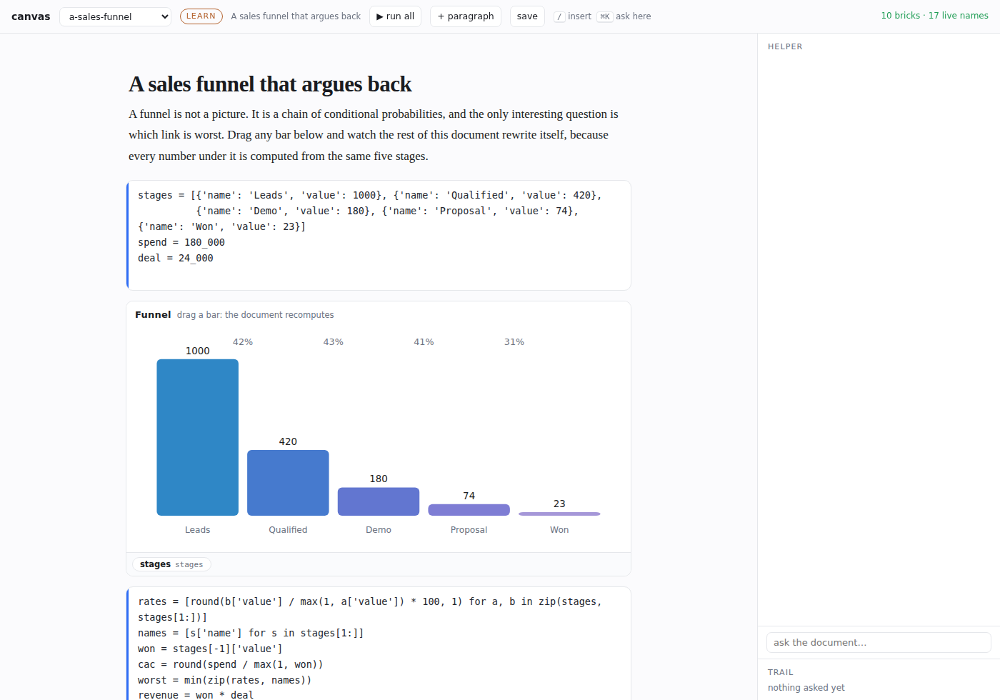

# leela

> creative workspace that starts with coding

A browser IDE for notebooks, files and live variables, with a coding agent in the same window.
It runs as a web application on loopback, or as a packaged desktop application on macOS and
Windows.

This repository is the workspace, the notebook, the agent surface and the frontend. The parts
that are not specific to an IDE are their own packages, and Leela imports them by name.

- [kunda](https://github.com/vedicreader/kunda) runs the kernels and finds the interpreters.
- [dhrishti](https://github.com/vedicreader/dhrishti) inspects a live namespace from inside the
  kernel that owns it.
- [ramabana](https://github.com/vedicreader/ramabana) is the agent harness.
- [shalya](https://github.com/vedicreader/shalya) is the toolset and the host contract.
- [gheasy](https://github.com/vedicreader/gheasy) is the git plumbing.
- [kavacha](https://github.com/vedicreader/kavacha) is the native window and both freezer
  definitions.
- [pullup](https://github.com/vedicreader/pullup) is the project, release, deploy and workflow
  model behind the Ship it panel.

## Install

Leela is not on PyPI: the `leela` package there is an unrelated 2015 project. Install it from this
repository, which needs a GitHub sign-in that can read it (`gh auth login`):

```sh
uv tool install git+https://github.com/vedicreader/leela                      # the `leela` command
uv tool install "leela[local] @ git+https://github.com/vedicreader/leela"     # + on-device inference (mlx, llama). Large
```

To work on it, clone it and run it from the checkout:

```sh
git clone https://github.com/vedicreader/leela && cd leela
uv sync
uv run leela .
```

### Windows (WSL)

Run Leela inside WSL, not in Windows itself. Install it in the WSL shell as above and start it with
no window of its own:

```sh
leela --shell none .
```

Open the URL it prints, `http://localhost:5010` by default, in a Windows browser; WSL forwards
`localhost`. Export model keys, such as `AZURE_OPENAI_API_KEY` or `OPENAI_API_KEY`, in the WSL shell
that starts Leela (for example in `~/.bashrc`), not in Windows: Leela and its agent only see the
Linux environment. The same goes for `ramabana` and for a scheduled Dhrona batch.

The desktop application is a separate download. Each release attaches `Leela-macOS.dmg` and
`Leela-Windows.zip`, built by `.github/workflows/desktop-artifacts.yml` on the tag. Take them
from [the releases page](https://github.com/vedicreader/leela/releases). Nothing older than
0.1.3 carries a working one.

## Use

```sh
leela                      # the saved workspace
leela .                    # a folder
leela src tests            # one workspace, two roots
leela --app src tests      # two app windows in fossick's persistent CDP Chrome
leela --shell webview .    # a native desktop window, what the packaged app runs
```

In `--app` mode each folder gets its own `Workspace`, documents, agent, terminals and kernel
pool at `folder.localhost:5010`. `--app` picks the workspace shape. `--shell` picks what opens on
top of it, and it takes `chrome`, the default under `--app`, or `webview` for a native window, or
`none`. The same CDP Chrome backs [the inline browser](#the-browser-inside-leela) either way.
`--transport direct|gateway` picks the kernel transport. `--kernel ipykernel|ipymini` picks
the kernel. `--agent restricted|readonly|off` sets what the agent may touch. Run
`leela --help` for the rest.

## What it does

### Editing

Notebooks and files sit side by side in CodeMirror 6. A `.py` file runs as a script in the
tab's own kernel. The script gets `__main__` and an argv, and Variables then holds every name it
defined. Use `▶ file` for the whole file and `▶ sel` for a selection. `mod+e` opens a
recently-used switcher. Overflow tabs fold into a `+N` menu. Autosave is atomic, mirrored
into IndexedDB, and version-checked against disk. Cells fold, headings build an outline, and
every pane minimises.

### Rust and JavaScript notebooks

A notebook's kernelspec says what its cells are, and Leela runs three of them. Python is a managed
ipykernel as before. Rust and JavaScript run on an installed Jupyter kernel where one exists, either `evcxr_jupyter`
or `deno jupyter`. Where none exists they run on Leela's own runner. A Rust cell becomes part of
a scratch cargo crate that grows. Rustc's diagnostics then arrive as the cell's error output,
named `E0382`, with the compiler's own rendering underneath. JavaScript cells run against one
long-lived node context, and a binding made in one cell survives into the next. `notebook language`
in the command palette switches a notebook over. See
[a notebook that is not Python](docs/languages.md).


### Staging a folder of a language you have just met

`git add` honours `.gitignore`. A folder you have just created has no `.gitignore`, and `target/`
or `__pycache__` therefore go in with everything else. `stage this folder, ignores first` writes the rules
the folder's project kinds need, covering Rust, maturin, Python and Node. It detects each kind
from the files that declare it, writes a rule only where `git check-ignore` reports one missing,
and then stages. The rules go in the folder's own `.gitignore`, because `/target/` at the root
of a repository does not match `mycrate/target/`.

The tree colours every file and every folder by its state: staged, modified, untracked, ignored,
conflicted. A folder takes the strongest state under it, and a new one therefore reads as untracked before
you expand it.

<p align="center">


</p>

### Live variables

Each notebook tab owns a real kernel with a dhrishti inspector inside it. kunda supervises the
kernel, finds the interpreters and builds the kernelspec; the tree stays responsive while a cell
runs. `--kernel ipymini` puts execs and shell-channel calls on a subshell, which keeps
completion out of the queue behind a long cell. On a cell that awaits two seconds, a
completion request drops from about 3s to about 275ms
([screenshot](docs/screenshots/web-concurrency.png)). A trailing value opens in a lazy lens.
Prefix the Variables filter with `=` to evaluate against the watched runtime.

### The agent

The turn runs on a local or a cloud model. Completions, summaries and sub-agent fan-out go
to the local one either way. Every call is a lifecycle card. You can edit it, read its
dry-run diff, approve and run it, reject it with steering, retry it, or roll it back.
Autopilot, guided and directed modes decide how much of that you see. Compaction is
surgical and appears in the timeline. Turns fork from any revision. A prompt cell saves the
answer in the notebook cell, as markdown that Jupyter can still read. The charter under
state layers context by organization, project, task and branch, then puts it in the
briefing. Skills come from `pyskills` entry points and `SKILL.md` directories. The harness is
[ramabana](https://github.com/vedicreader/ramabana), which `leela.agent` aliases.
Nothing chooses a provider for you. When the agent's model cannot run, the agent pane lists the
providers it can use (OpenAI, Azure OpenAI, AWS Bedrock, Anthropic, Gemini, OpenRouter, Claude
Code, Codex, a local model) and what each needs, and **+ model** adds one; see
[docs/integration.md](docs/integration.md#providers-azure-openai-and-aws-bedrock).

### The canvas

One markdown file holds prose, code cells, components embedded
from a package, sketches written in the file, PDFs and video. Each brick recomputes when a name it
reads changes. Cells run in dependency order rather than document order. Clicking inside an
embedded component writes a name into the namespace, which makes a component an input as much as
an output. You reach the helper from the margin, from an `ask` brick, and from `mod+k` on any
selection. It edits the document through eight tools and no others. Leela owns a skill covering
what the helper knows about a canvas, and pushes that skill onto the agent while a canvas is open.

The editor holds what every document of this shape holds. A gutter appears on hover, with a drag
grip and an insert button. `/` opens a filtered block menu. A format bar appears on a selection,
with Ask AI in it. `Enter` splits a block at the caret. Both themes ship.

Six canvases ship in `examples/canvas/`, over sales, astrology, quantum tunnelling, cell biology and
two on building software. Open one with `+canvas` in the files strip, or `new canvas` in the command
palette. See [the canvas](docs/canvas.md).



### Search and memory

Code goes through [kosha](https://pypi.org/project/koshas/): FTS5, embeddings, a call graph
and notebook cells, behind `mod+shift+f`. Ripgrep is the fallback. Command-click reaches a
definition. Prose goes to a [vishalakshi](https://github.com/vedicreader/vishalakshi) vault
over litesearch. It holds every page read and every research source. The agent recalls one
with `memory_search`, `memory_read` and `ask_memory`, rather than paying to
search the live web again.

### The vault

Tools > Vault opens a workbench tab for shelves, search, imports, feeds, API specifications, and topics.
Paste a page, paper, repository, video, or folder. Folder imports show their plan before indexing.
`@` completes vault documents. Search results and document rows can attach sections to an agent question.
See [the vault](docs/vault.md).


### Research

[fossick](https://github.com/vedicreader/fossick) runs the web search and the extraction to
clean Markdown. Sources stay beside the reader, and a digest cites them. Everything renders
through [mdhtml](https://github.com/AnswerDotAI/mdhtml), which keeps a pasted `<script>` visible
rather than running it.

### The browser

A page opens as a tab. Chrome renders it offscreen in fossick's persistent profile and streams
frames in. A research result is a tab beside the notebook, on the sessions you already
signed in to. **read** lifts it to Markdown from the DOM after the scripts ran.
See [the browser, inside leela](#the-browser-inside-leela).

### Git

Source control is a six-part workspace: Changes, Review, Branches, History, Repository and
All repos. Diffs open as editor tabs, unified or side by side, with hunk staging and a
revert arrow per hunk. Merge and rebase open a plan that mutates nothing. Blame reads a
notebook as cells
rather than as JSON. `leela ~/code` opens a folder of checkouts and answers the plural
questions: which are dirty, which are behind, which are unpublished. Fetch, pull and push
run across every one at once. Lazygit is in the dock.

### Ship it

Workflows draws `.github/workflows` as jobs and `needs` edges. Recent run results paint onto
the same boxes, and a form builds new ones.
[gheasy](https://github.com/vedicreader/gheasy) writes every file, and one of those files is the
[fastship](https://github.com/AnswerDotAI/fastship) release for a Python package outside an nbdev
template.

Release runs the flow the project already uses, and each step is a pty step keeping its own exit
code. It runs nbdev's four commands where `settings.ini` or `[tool.nbdev]` says so. It runs
maturin's flow for a crate with Python bindings. That flow tests, builds a wheel, refreshes the
workflow and tags, and then the runners build every platform and publish. It runs `cargo publish`
for a crate without bindings. It runs fastship's five commands where a `pyproject.toml` declares
no nbdev. A project that packages a desktop app gets two more steps, after the release the
artefacts attach to.

Deploy runs the project's `deploy.py` stage by stage, or scaffolds the first one from dockeasy,
vpseasy and cfeasy. Drive is the same deploy taken apart, one library call per step. A failure
names the deepest frame in your own

<p align="center">


</p>
packages, rewritten to the checkout you have open. Secrets stay in dockeasy's store and are
never sent to the browser.

### Keys and buttons

Every action has a button, a palette entry at `mod+shift+p`, and a chord you can rebind.
See [keys and buttons](#keys-and-buttons).

## Watching something run

An inspector lives inside a process. That gives one rule:

> A process leela started under a run configuration is watchable. A process you started
> anywhere else is not, unless it says so itself, in one line.

Run configurations live in `.leela/runs.json`:

```json
{"runs": [
  {"name": "api",   "cmd": "uvicorn app:app --port 8000", "watch": "app"},
  {"name": "train", "cmd": "python train.py"}
]}
```

leela imports `watch` before it runs `cmd`. Uvicorn's own `import app` then finds the module
already loaded, and the panel shows that namespace while the server serves. leela infers
`watch` from `app:app` when you leave it out. The run button is `ctrl+alt+d`. The env picker
is `ctrl+alt+e`. `--reload` is the exception: the reloader runs your app in a child process,
where the inspector is not.

Anything else joins by asking:

```python
import dhrishti.serving as ds; ds.serve(name='api')
```

## Keys and buttons

Some chords never arrive. Terminal.app cannot distinguish some modified keys. macOS uses
Option to compose. Chrome reserves combinations. The browser therefore has one context-aware
router, and it matches modified printable shortcuts by physical key code. `mod` is Command in
a macOS browser and Control elsewhere. `hyper` is Command+Control+Option+Shift, or
Control+Alt+Shift elsewhere.

Notebook keys follow PyCharm and Jupyter. `mod+enter` runs the cell. `shift+enter` runs and
selects below. `alt+enter` runs and inserts below. `alt+shift+up/down` moves a cell.
`mod+shift+enter` runs everything. Rarer actions ship unbound with a button and a palette
entry, because the chords that survive your browser are yours to pick.

Rebind in `keys.json` in leela's config dir, or wherever `$LEELA_KEYMAP` or `--keymap` points:

```json
{"keys": {"run_cell": "mod+enter ctrl+y", "palette": "mod+shift+p", "quit": ""}}
```

Separate chords with spaces. `""` unbinds. Put only what you changed in `keys`. Every action
absent from it follows leela's default, including when that default moves in a later release.
`leela --write-keymap` writes the file and lists every action and its default under `_defaults`,
which leela rewrites and never reads. Copy a line out of it to change one more. Editing in the
browser under keys applies without a restart. leela skips anything unparseable, unknown or
conflicting, reports it, and keeps that action's default. A typo cannot stop leela starting.

## Layout

```
leela/
  agent/          the alias seam: `leela.agent.*` is `ramabana.*` (one `__init__.py`)
  core/           what every block may import
    block.py      `Ctx` (capabilities), the block contract, ordered wiring
    langs.py      the languages Leela runs, serves and highlights
    keys.py       single-source keymap and the user's overrides
    ui.py         button bars and shared atoms, over those same actions
    text.py       diffs, fuzzy ranking, markdown block structure
    session.py    open docs, running cells, the debugger, the journal
    backups.py    the checkpoint a save writes, outside the repository
    envs.py       which values a project needs; dockeasy keeps them
    web.py        shared route helpers
    projects.py   which folders are open, and which were open lately
    inspectors.py the inspector registry, without importing dhrishti's kernel half
  blocks/         one folder per feature: `connect(app, ctx)` plus a `CAPS` tuple
    nb git search memory agent runtime research workflows pipelines drive
    fs term keys tabs vars runs stack refactor lsp debug editor settings workspace
    runtime       kernels, model engines, and the runners for a language with no kernel
    browser       a CDP page as a tab: screencast in, input out
    vault         the corpus, what fills it, and the queue that does the filling
  workspace.py    open folders, open tabs, and which kernel each tab talks to
  app.py          the FastHTML IDE: `ide_app`, `serve_ide`
  desktop.py      the native window: pywebview, the CDP boot, the macOS open event
  cli.py          the `leela` entry point
  static/         the browser client. `vendor/` holds the committed npm bundles
leela_app.py      what py2app and py2exe freeze: server on a thread, window on the main one
packaging/        the platform build definitions and the mark
```

A block imports `leela.core` and never another block. [docs/blocks.md](docs/blocks.md) has
the contract. [docs/integration.md](docs/integration.md) says what belongs in a dependency
rather than here. [docs/](docs/README.md) indexes the rest.

## Standalone desktop builds

Packaged, leela is a native window with a Python server behind it and a headless Chrome
beside it. The window is [pywebview](https://pywebview.flowrl.com/) over the platform's own
webview: WKWebView on macOS, WebView2 on Windows. It points at a loopback port chosen at
launch. Chrome is not in the bundle. `--app` and the inline browser both drive the persistent
CDP profile fossick keeps in `~/.cache/fastcdp`. It is the copy of Chrome the machine already
has, with the logins it already has.


```sh
uv sync --extra desktop --extra macapp --group dev
python setup_app.py                 # dist/Leela.app
python tools/build_release.py       # + dist/Leela-macOS.dmg
```

```powershell
uv sync --extra desktop --extra windows --group dev
python setup_app.py                 # dist\Leela\Leela.exe
python tools\build_release.py       # + dist\Leela-Windows.zip
```

`setup_app.py --check` says what it would do first. On macOS it builds against a framework
Python and makes one when the active interpreter is uv's standalone build. py2app copies
stdlib extension modules such as `zlib` out as files, and a standalone build has them linked
in. Windows uses py2exe through the same driver, and produces a folder rather than one file.

The definitions are `packaging/macos/setup.py` and `packaging/windows/setup.py`. The mark
lives in `packaging/assets`: an ICNS for macOS, an ICO with executable metadata for Windows.
`leela_app.py` is the script they freeze. It picks a free port, starts the ordinary
`leela --app` server on a daemon thread, and gives the main thread to the window. Cocoa allows
no other order.

`tests/test_packaging.py` checks what a green build would not. That the asset walk reaches
`vendor/fonts/`. That the plist carries the `NSAllowsLocalNetworking` exemption WKWebView
needs for a loopback URL. That Windows keeps modules as files, which lets a kernel subprocess
import them.

### Cutting a release

Leela is a fastship project, and the Release panel therefore runs `pytest`, `ship-changelog`, `ship-gh`,
`ship-pypi`, then the two desktop steps, then `ship-bump`. From a shell the same sequence is:

```sh
pytest tests -q
ship-gh --no_changelog --no_editor --yes    # commit, push, tag, create the GitHub release
ship-pypi
python tools/build_release.py               # this platform's bundle, into dist/
python tools/build_release.py upload        # attach it to the release for this version
ship-bump && git commit -am bump && git push
```

Write the `## <version>` section of `CHANGELOG.md` before `ship-gh`. That section is the
release body.

The tag builds the other platform. `.github/workflows/desktop-artifacts.yml` runs on a push of
`v*` or of a bare version tag. It accepts both, because `ship-gh` tags a Python project `0.1.3`
while fastship's Rust, Zig and npm flows push `v0.1.3`. Each job exports `uv.lock` as the
bundle's requirements before it freezes anything. Letting pip resolve `>=` fresh on a runner
shipped the 0.1.2 bundle a jupyasyncclient whose kernel answered 500 to every cell. Each job then runs
`tests/test_packaging.py` against the artefact it built and uploads it to the release the tag
names. Set `LEELA_CODESIGN_IDENTITY` for Developer ID signing. Notarization credentials stay in
the release environment.

`python tools/build_release.py upload` finds the release under either tag spelling and refuses
with the command to run when there is none.

The window needs no build. From a checkout:

```sh
uv sync --extra desktop
leela --shell webview .
```

### Opening a project without a command line

You double-click a packaged leela, and nothing tells it which folder you meant. It takes the
folders the desktop handed it, else the set it had open when it was last closed, else none.
Then it opens the welcome screen rather than guessing. `leela` from a shell means "here", and
the shell has already chosen where here is. A double-clicked application has no such answer,
and the old guess, home, handed kosha every file you own to index.


The remembered set follows the workspace rather than the arguments it started with. A folder
opened from inside the app is there next launch, and one you closed is not. Closing a project
is not forgetting it. It stays on the welcome screen until you say otherwise. The ways in that
involve no typing:

- The platform's folder chooser, from **Open a folder** or **browse…**. A web page cannot
  produce a directory path, so in the packaged app this comes from the native window through
  `window.pywebview.api`.
- **Open With -> Leela** on a folder, and a folder dropped on the Dock icon. macOS delivers
  that to the *running* application rather than through argv. `leela.desktop` answers the
  `odoc` Apple Event and gives the folder a workspace and a window of its own. To put a
  second folder in the window you are already in, use `add…` in the files bar.

Windows has no such event. Explorer starts a new process with the path in argv, which the app
already reads. To put leela on a folder's context menu:

```
reg add "HKCU\Software\Classes\Directory\shell\Leela" /ve /d "Open in Leela" /f
reg add "HKCU\Software\Classes\Directory\shell\Leela\command" /ve /d "\"C:\Path\To\Leela.exe\" \"%V\"" /f
```

## The browser, inside leela

A page opens as a tab. Chrome renders it offscreen in the persistent CDP profile and streams
frames into a canvas over `/browser/ws`. Mouse and keyboard go back the other way. A result
from Research is therefore a tab beside the notebook, on the sessions fossick already
signed in to.


`alt+shift+o` opens an address. **Tools -> Pages open in the browser…** adopts one Chrome
already has, whether leela opened it or fossick did. **read** lifts the page to Markdown
through the same `fossick.to_md` research uses, but from the DOM *after* the scripts ran and
after the login. A plain fetch cannot reach that. **remember** files it in the vault as an
ordinary source.

Nothing renders web content in leela's process. Chrome renders, and leela draws JPEG frames.
Every navigation goes through `fossick.check_url`, which stops anything pointing the browser back at
leela's own unauthenticated loopback server unless `FOSSICK_ALLOW_PRIVATE` says so. The panel
keeps the keyboard the way the terminal does. A page's own `j`, `/` and `?` reach the page.
Only the chords that get you back out stay leela's.

Frames cross the socket as raw JPEG rather than base64 in JSON, which is a third fewer bytes.
They decode through `createImageBitmap` off the main thread, which drops any frame arriving
mid-decode rather than queueing it. Latency on a picture nobody will see is worth nothing.
Hiding the window stops the cast. The page stays loaded, and resuming asks for a frame at once.

## What it costs to run

`tools/profile_app.py` measures the three things that judge the desktop app. Each runs in a
fresh subprocess, because import cost is order-dependent and RSS is cumulative.

```sh
python tools/profile_app.py            # all three
python tools/profile_app.py --imports  # what is on the startup path, and what it drags in
```

| | before | now |
|---|---|---|
| `import leela.app` | 766ms · 109MB | **377ms · 48MB** |
| process start to first page served | 786ms | **587ms** |
| one workspace, resident and idle | 119MB | **74MB** |
| one screencast frame, on the wire | 10,775 bytes | **8,080 bytes** |
| a launch that never opens a web tab | + ~900MB of Chrome | **no Chrome at all** |

The last line is the largest. A headless Chrome runs to some hundreds of megabytes across a dozen
processes. That is more than the workspace beside it, and most sessions never open a web tab. So the
first page that wants one starts it. `LEELA_CDP_EAGER=1` trades that memory back for the
second or two the first tab would spend waiting. Research still offers to open pages while the
browser is cold. `/browser/ready` answers "is there a Chrome to drive", not "is one running".

Nearly every byte of the first three lines was dhrishti, which the server imported for two constants
and a directory listing. dhrishti belongs *inside a kernel*. `dhrishti.core` imports IPython,
pandas and numpy at module scope, and leela's server never formats a live value.
`leela/core/inspectors.py` reaches `dhrishti.registry` for two things: the profile and sort
menus, and the reader for the registry that in-kernel inspectors write themselves into. It
reaches `kunda.support` for the import classifier. Neither import pulls in the kernel half. `tests/test_inspectors.py` imports
the real dhrishti and fails if the two disagree, round trip included. The kernel side is
untouched, which is why the dependency stays. The IPython still resident arrives through
`fasthtml.pico`, which `fast_app` imports even for `pico=False`. That one is a one-line fix
upstream.

## Develop

```sh
uv sync --group dev --python 3.12
uv run pytest tests -q   # `-m ""` adds the slow ones: browsers, real kernels, a real model
```

`tests/conftest.py` fakes the kernels, and the harness tests drive a `FakeBackend` over
scripted replies. The suite needs no ipykernel and no gigabytes of weights.

Each IDE client module sits beside the feature it serves, as `leela/blocks/<block>/*.js`, with
the shared vocabulary in `leela/static/js/`. `tools/build_ide_js.py` concatenates them, in the
order its `LAYERS` fixes, into the committed bundles `leela/core/web.py` names in
`IDE_BUNDLES`: `lee-core.js`, `lee-agent.js` and `lee-ide.js`, served as three deferred tags in
one lexical scope. Run it after editing a module, or run `--check` to see whether a bundle has gone stale. It
refuses to build a module it cannot find, and one it finds but the order never names. The repository commits the npm bundles in `leela/vendor/` too, and an
install needs no node:

```sh
python tools/build_ide_js.py [--check]
cd frontend && npm install && npm run build
```

## License

Apache-2.0
