# Canvas

A canvas is a document that runs. Prose, code, embedded components, simulations, PDFs and video sit
in one file, and the things in it recompute when what they read changes.

The notebook Leela already has is a list of cells. A canvas is prose with everything else inside it,
and its cells are not the point of the document. `leela/blocks/canvas/` is the block.
`examples/canvas/` holds six of them.

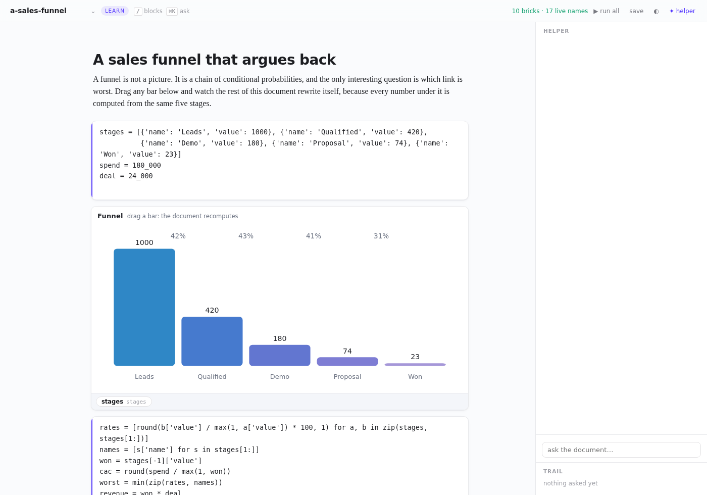

## The file

A canvas is markdown. `*.canvas.md`. Prose is prose. Everything else is a fenced block or a
comment-wrapped region, and both survive a plain markdown renderer.

````md
```canvas code id=c1
tokens = 1200
```

```canvas brick id=b1 src=lego.bricks:thrifty.costs emit_row=picked
bind rows = rows
prop height = 220
```

<!--canvas note id=n1-->
An **aside**, still rendered by anything that reads markdown.
<!--/canvas-->
````

Fenced kinds: `code`, `ask`, `brick`, `sim`, `data`, `pdf`, `video`. Wrapped kinds: `reply`, `note`,
`quiz`. Anything else in the file is a `text` brick.

The parser is a line scan rather than a pair of regular expressions, because a canvas fence inside a
longer markdown fence is an example of one and not one. A document about canvases is a canvas.
Windows line endings read the same as Unix ones. Two bricks cannot share an id: the second is given
a fresh one on read, because otherwise every op on the first would reach the second in silence.

A `pdf` brick with a relative `src` is a file beside the canvas, served by `/canvas/file`, which
resolves under the canvas directory and refuses anything above it.

A brick body holds `bind <port> = <expression>` and `prop <key> = <value>` lines. A code brick body
is the code, kept exactly, and never read for directives.

A canvas stores no outputs. Opening one runs it. The file therefore diffs to what somebody changed
and nothing else, and `test_canvas.py` asserts that a canvas which has been opened, run, wired and
asked questions of saves back byte for byte.

## The dataflow

Code bricks share one namespace and run in dependency order rather than document order. `defs_of`
reads what a brick defines from its AST; `reads_of` reads what it needs. `order` sorts them. A cycle
falls back to document order.

`downstream(bricks, names)` is what makes the document live. It returns every code brick whose
inputs include one of `names`, transitively, followed by every brick with a binding that reads one.
Setting a name reruns exactly that set.

Bindings are expressions evaluated against the namespace. A binding that raises reports the error on
the brick rather than blanking it.

## Components

A component is an iframe. The document and the frame exchange four messages and nothing else.

| message | direction | meaning |
|---|---|---|
| `brick:ready` | frame to document | the frame has loaded, with its manifest |
| `brick:props` | document to frame | resolved port values |
| `brick:height` | frame to document | how tall it wants to be |
| `brick:emit` | frame to document | a value the person produced by using it |

`brick:emit` is why a canvas is not a dashboard. Clicking an organelle, a rasi or a funnel bar writes
a name into the namespace, and every cell that reads that name reruns. A component is an input as
much as an output.

The name a port writes to is `emit_<port>` in the brick's attributes, so two funnels in one document
do not fight over `stages`.

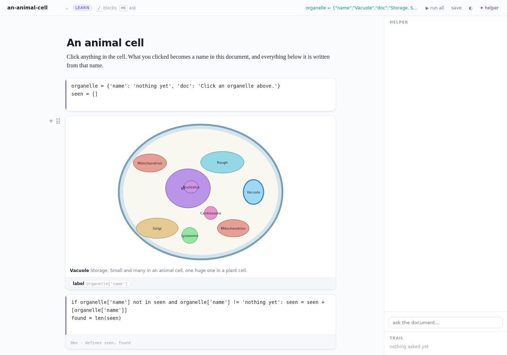

## Wiring

Ports are declared by the package that owns the component, not by the document. `lego/bricks/` is
that package here: each brick declares its ports, what it emits, and the code that fills it.

Picking a component from the palette inserts it, fetches its wiring, puts that code in the document
as an ordinary code brick, and binds the ports it filled. The wiring is visible and editable. There
is no hidden connection.

A package ships its wiring twice. The first form imports the package. The second form calls the
host that owns it. The document runs the first, and falls back to the second when the import fails,
which is what happens when the package is not installed beside the document.

```python
from lego.muhurtha.panchanga import Place, day_panchanga
day = day_panchanga(Place(12.97, 77.59, 'Asia/Kolkata', 'Bengaluru'), date.today())
```

```python
import json, urllib.request
_ports = json.load(urllib.request.urlopen('http://127.0.0.1:5001/bricks/data/panchanga.day'))
day = _ports['day']
```

The ⚙ in a brick's rail opens the wiring panel: every port, its expression, what it currently
resolves to, and the names in the namespace to pick from.

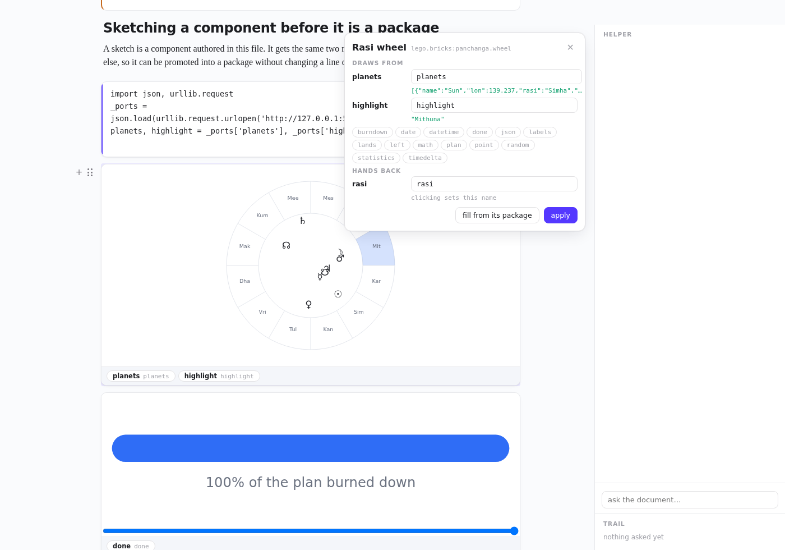

The palette is what the host publishes, grouped by the block that owns each component.

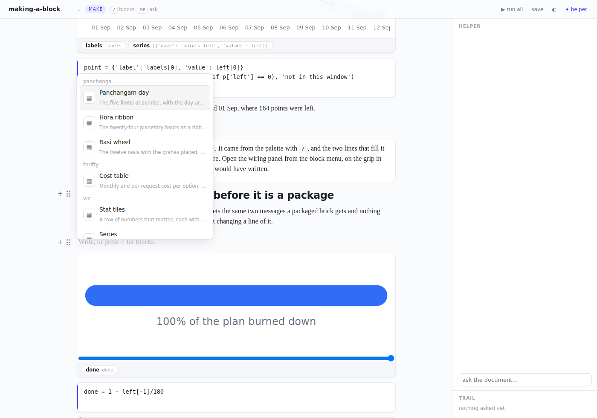

## The helper

One helper, reachable from three places: the margin, an `ask` brick in the document, and `mod+k`
anywhere. All three are the same turn. What differs is the selection that travels with it.

Its reach into the document is eight tools and no others.

| tool | does |
|---|---|
| `canvas_read` | the document as it stands |
| `canvas_insert` | a new brick at a position |
| `canvas_replace` | rewrite one brick |
| `canvas_remove` | take a brick out |
| `canvas_bind` | point a port at an expression |
| `canvas_run` | run a code brick and let the dataflow settle |
| `canvas_answer` | prose attached to the question that asked for it |
| `canvas_values` | read names out of the namespace |

Every one goes through `apply_op`, which is also what the person's own edits go through. There is no
second path into the document.

A turn streams `step`, `chunk`, `op`, `answer`, `done`. `op` events are applied as they arrive, so a
brick appears while the turn is still running. Steering is a queue per turn: text posted to
`/canvas/steer` is taken at the next step boundary and replans the rest of the turn.

The trail is the last twelve questions, each with the brick it came from and the selection it
carried. It goes into the next turn's context, which is why a follow-up needs no preamble.

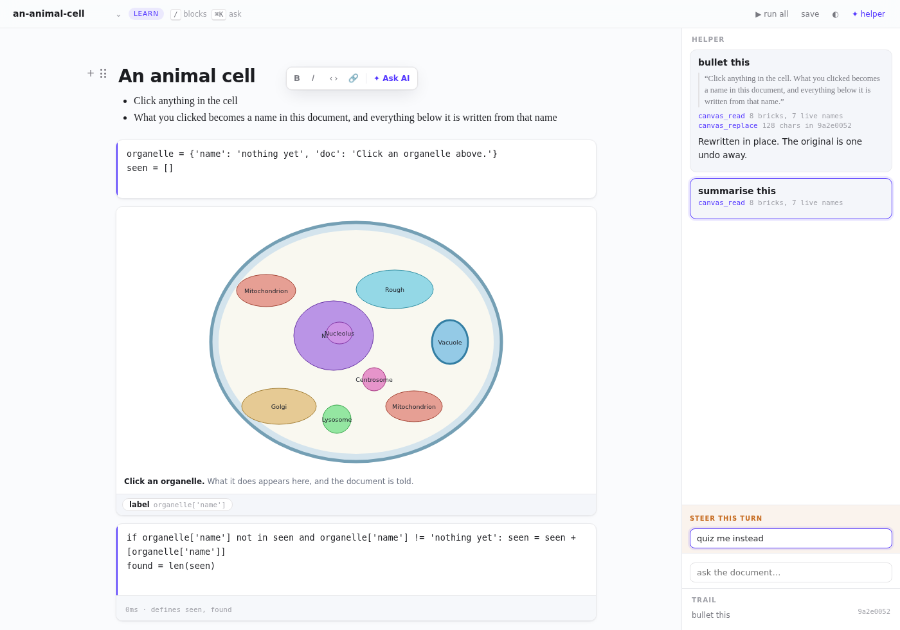

## Canvas mode

What the agent knows about a canvas is a skill, and Leela owns it. `leela/skills/canvas.py` is the
body: the file format, the dataflow, what a component emits, the eight tools, and how to work in one.

It is not a `pyskills` entry point. A skill that is only true inside a canvas should not reach every
agent that has Leela installed. `leela.skills.push(agent, 'canvas')` puts it on the agent's registry
when a canvas opens, `drop` takes it off when the canvas closes, and the eight tools go on and come
off with it. `Agentic.open` and `Agentic.close` are those two calls.

Ramabana holds none of this. `Agent.skills` is `discover(..., extra=registry.skills)`, so a pushed
skill reaches the skill index and `read_skill` with no change to the agent core. The proposal on
`ramabana`'s branch is for the tools to become a shalya capability group; the skill stays Leela's
either way.

The skill is also the stand-in's source. A question about the canvas is answered out of the section
of the skill that covers it, so there is one text to keep right rather than two.

## The model

`helper_for(agent)` returns `Agentic` where a model is configured and `Scripted` where none is.
`Scripted` is deterministic: it reads the same `Ask`, calls the same tools, and emits the same
events. It has no judgement, and it has no facts: a question about a word is answered by finding
where this document already explains it, and a word the document never explains gets no answer.
Which component to embed is scored against what the host publishes, not against a table kept here.

`Agentic` runs the real turn. It is not exercised in the spike, because the spike has no model.

## The editor

The document is edited in place. Prose stays rendered while you work in it and goes back to markdown
on the way out, so selecting a sentence to ask about it does not change what the sentence looks like.

| where | what |
|---|---|
| gutter | `+` inserts under the block, the grip drags it, clicking the grip opens what else it can do |
| `/` on an empty line | the block menu, grouped, filtered as you type, driven by the keyboard |
| a text selection | bold, italic, code, link, and Ask AI, which is the inline turn |
| `Enter` | splits the block at the caret. `shift+Enter` is a line break inside one |
| `Escape` | leaves the text and picks the block. Then arrows move, `Enter` enters, `Backspace` deletes |
| `mod+k` | ask, anchored wherever you are |
| `mod+j` | the helper margin |
| `mod+b`, `mod+i`, `mod+e` | the three marks, applied to the markdown rather than to the HTML |
| `mod+enter` | run this cell. `mod+shift+enter` runs the document in dependency order |

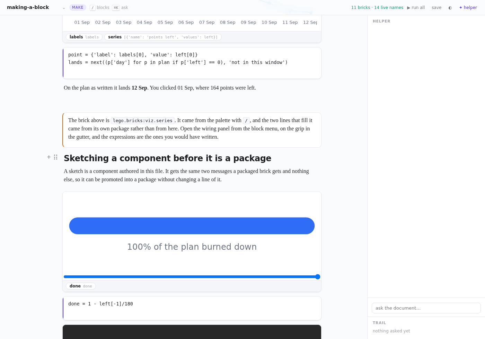

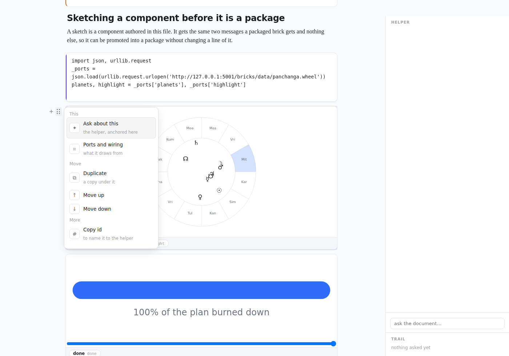


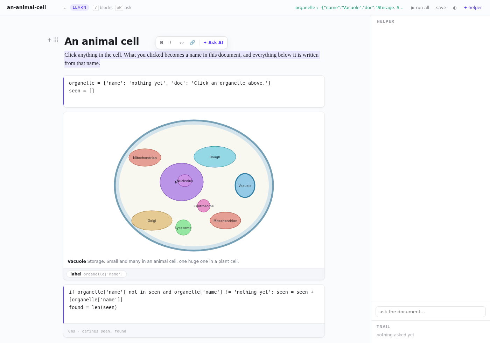

Both themes, and every embedded component follows the one the document is in.

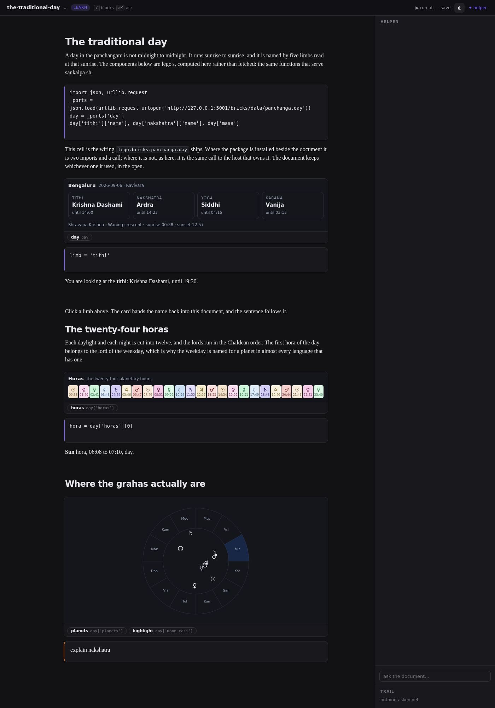

Marks are applied to the file, not to the rendered HTML. `document.execCommand('bold')` would put a
`<b>` in that the markdown writer has to guess about.

The type scale, the token names and the popover shape follow BlockSuite's, so a canvas put beside an
editor built on it does not read as a different application. Both themes are in `canvas.css`, and
`test_canvas.py` asserts the dark half names no token the light half lacks.

## Modes

`mode: make` and `mode: learn` in the frontmatter. The substrate is the same. The palette and the
default bricks differ. `a-sales-funnel`, `the-traditional-day`, `tunnelling` and `an-animal-cell` are
learn. `pricing-a-run` and `making-a-block` are make.

Nothing in the runtime branches on the mode. It is a label on the document and a filter on the
palette.

## Running it

The block is connected in `leela/blocks/__init__.py` and serves `/canvas` from the IDE app. It also
runs on its own, with no kernels, no agent and no workspace:

```sh
uv run python tools/canvas_spike.py                  # http://localhost:5002/canvas
BRICK_HOST=http://127.0.0.1:5001 uv run python tools/canvas_spike.py
```

The components come from a lego app on `BRICK_HOST`. Without one, the palette is empty and bricks
already in a document draw with the sample data their package declares.

The canvas serves its own bundle from `/canvas/js` rather than joining the three IDE bundles. Those
three share one lexical scope, and a separate document does not want to be in it.
`build_ide_js.OWN_BUNDLE` names the blocks that do this.

## Walkthroughs

Recorded against this branch, with the scripted helper and a lego app on 5001.

| what it shows | file |
|---|---|
| dragging a funnel bar rewrites every number under it | [`media/canvas/canvas-reactive.webm`](../media/canvas/canvas-reactive.webm) |
| clicking an organelle, an inline rewrite, an ask and a steer | [`media/canvas/canvas-helper.webm`](../media/canvas/canvas-helper.webm) |
| slash menu to palette to a component wired from its package | [`media/canvas/canvas-wiring.webm`](../media/canvas/canvas-wiring.webm) |
| the barrier sliders driving the simulation and the sentence under it | [`media/canvas/canvas-learn.webm`](../media/canvas/canvas-learn.webm) |

## The six shipped canvases

| canvas | mode | what it exercises |
|---|---|---|
| [a-sales-funnel](../examples/canvas/a-sales-funnel.canvas.md) | learn | a component as an input, and prose bound to what it writes |
| [the-traditional-day](../examples/canvas/the-traditional-day.canvas.md) | learn | three components off one data source, wired over the host |
| [tunnelling](../examples/canvas/tunnelling.canvas.md) | learn | a sketch driving a simulation, and a video |
| [an-animal-cell](../examples/canvas/an-animal-cell.canvas.md) | learn | click-to-name, an accumulating list, a check |
| [pricing-a-run](../examples/canvas/pricing-a-run.canvas.md) | make | a table you pick a row from, and a slider that repeats the sum |
| [making-a-block](../examples/canvas/making-a-block.canvas.md) | make | a function, its chart, and a component sketched in the file |

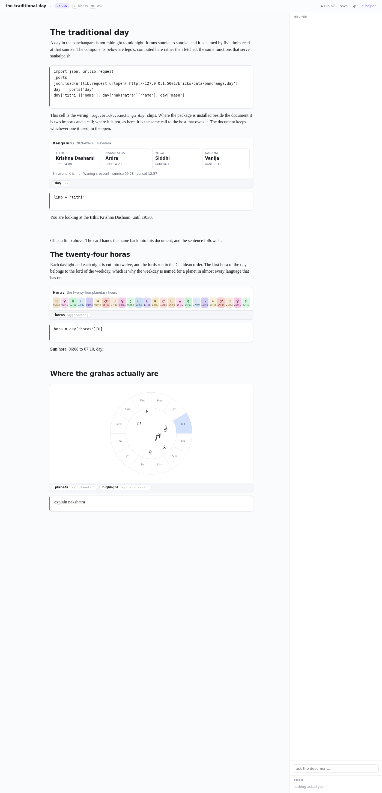

A PDF, a sketch and a chart in the same document.

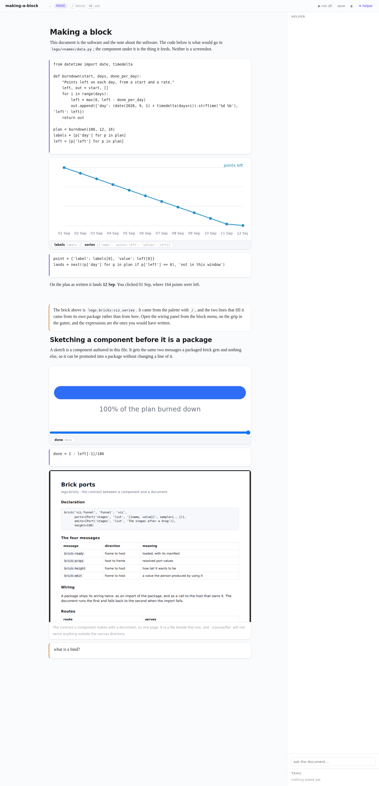

## What the spike does not do

- The runtime is `exec` in the web process, not a kunda kernel. Ordering, staleness and error shape
  are the real ones. Isolation, interrupt and restart are not there.
- There is no undo. `apply_op` is the single write path a history would hook, and nothing hooks it.
- Prose editing round-trips through `cvHtmlToMd`, which handles what `cvMd` can produce and no more.
  `mod+e` shows the markdown for a block where that is not enough.
- A canvas is a page, not a tab. Opening one inside the IDE means a tab kind, a mount, and a place
  in the command palette.
- `Agentic` has never run.
- Block selection is one block at a time. Dragging a range across several is not there.
- The markdown writer handles what the renderer can produce and no more. `mod+e` shows the source
  for a block where that is not enough.
