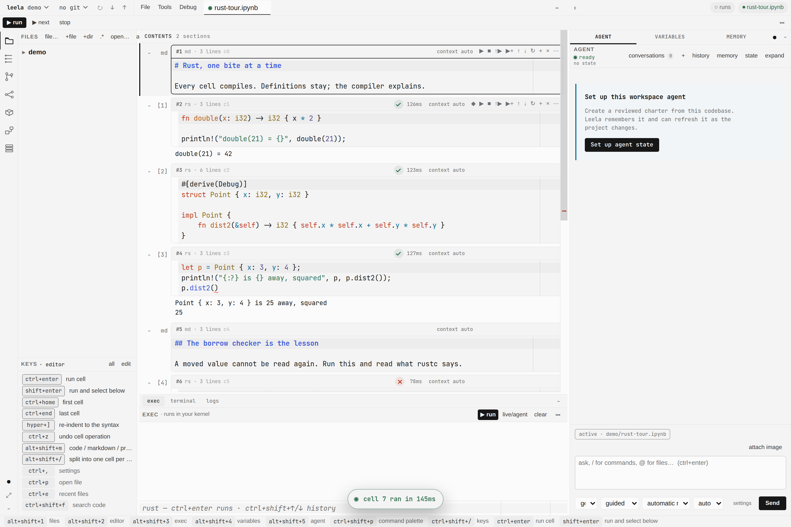
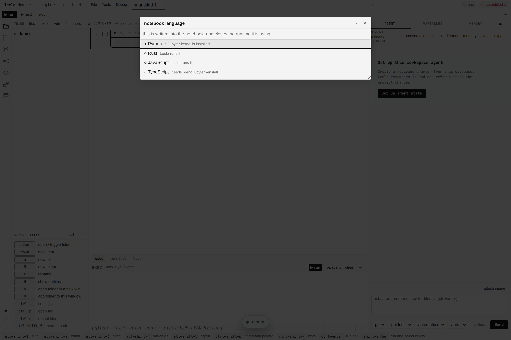
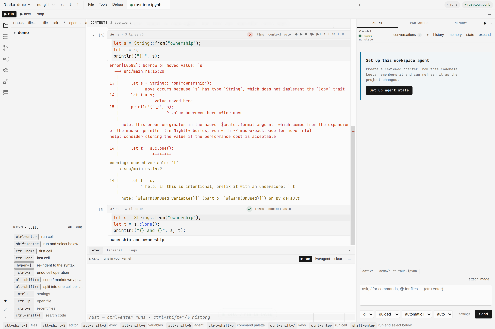
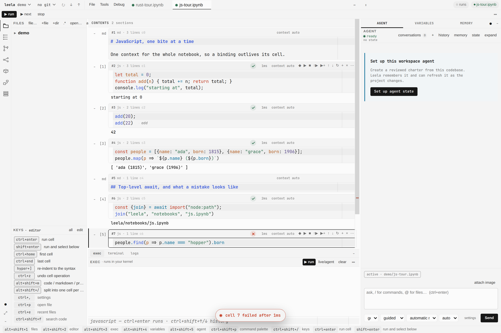
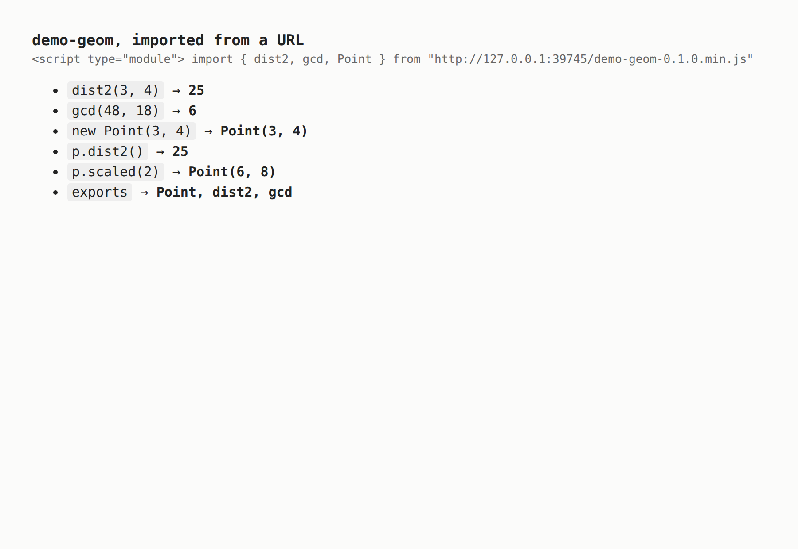

# A notebook that is not Python

Leela runs Rust and JavaScript cells in the same notebook it runs Python cells in. Same
`mod+enter`, same outputs, same file on disk. What differs is what is behind the cell.

## Where the language comes from

The notebook's own kernelspec. `metadata.kernelspec.language` is the record, and Leela now reads
it when the file opens and writes it back when the file saves. Before this, `Notebook.save` wrote
cells and nothing else, so a Rust notebook was a Python notebook again the next time it opened.

The command palette's `notebook language` sets it. The choice is written into the file and closes
whatever runtime the previous language was using. The action ships unbound: a button and a palette
entry, no chord. Each row says how that language would actually run here, which is not the same
question as whether Leela knows it.

`leela/core/langs.py` is the list. One record per language names its extensions, the Jupyter
kernelspec that runs it, the runner Leela falls back to, the language servers to try, and whether
dhrishti can read its namespace. Everything else asks that file rather than carrying its own list.

## What runs a cell

Three answers, in order.

1. **Python** runs the way it always has: a managed ipykernel or ipymini, pinned to the project's
   interpreter, with dhrishti inside it.
2. **An installed Jupyter kernel**, where there is one. `evcxr_jupyter` for Rust and `deno jupyter`
   for JavaScript both register ordinary kernelspecs, and Leela drives them through the same
   `jupyter_client` path it drives ipykernel through. Nothing in `Kernel.execute` was ever
   Python-specific: it speaks the Jupyter wire protocol and turns iopub messages into nbformat
   outputs.
3. **Leela's own runner**, when no kernel is installed. This is the path most people will be on,
   because it needs only the toolchain they already have.

## The runners

`leela/blocks/runtime/runners.py`. Both present the same surface as `Kernel`, so `/nb/run`,
`/nb/run/stream`, interrupt, restart and `Notebook.run` reach them unchanged. Neither has a
namespace dhrishti can read, so Variables stays empty and says why rather than showing a tree that
is not there.

### Rust: one scratch crate that grows

A cell is split into what outlives it and what does not. `fn`, `struct`, `enum`, `impl`, `trait`,
`mod`, `use`, `const`, `static` and `type` accumulate into the crate; everything else becomes the
body of `fn main`. A trailing expression without a semicolon is printed with `{:?}`, so a cell can
end in a value the way a Python cell does.

Then `cargo build --message-format=json`, and the diagnostics are the point. Each one becomes the
cell's error output with the code as its name, the message as its value, and rustc's own rendering
as the traceback. Warnings arrive on stderr. A cell that does not compile leaves the crate as it
was, so one bad definition does not poison every cell after it.

A cell costs about 120ms. The scratch crate lives under `$XDG_DATA_HOME/leela/scratch/rust/`, one
per notebook, kept between sessions. `//! dep: rand = "0.8"` on its own line adds a dependency.

### JavaScript: one node process that stays

`driver.mjs` holds a single `vm` context for the whole notebook and speaks newline-delimited JSON
over stdin and stdout. `let`, `function` and `class` from one cell are there in the next, because
V8 keeps top-level lexical bindings on the context. `console.*` streams as it happens. The last
expression's value is the cell's result.

Top-level `await` needs an async wrapper, and a `let` inside that wrapper would not outlive the
cell, so the keyword is dropped at brace depth zero and the assignment lands on the context. A
destructuring declaration keeps its parentheses. The driver's own frames are cut out of a stack
before it reaches the notebook.

`require` resolves from the scratch directory and `await import(...)` reaches the real module
loader, so npm packages installed there work.

## Language servers

`PyrightService` is now `LspService(root, lang)`, one per language, and the old name still points
at it. `core/langs.py` holds the candidates: rust-analyzer for Rust, typescript-language-server,
vtsls or `deno lsp` for JavaScript and TypeScript, and Python's unchanged list led by
basedpyright. `/lsp/hover`, `/lsp/symbols`, `/lsp/inlay-hints`, `/lsp/rename` and `/lint` route on
the file's language, and a language with no server installed says so rather than raising.

One thing is not done here: `frontend/editor.js` still asks the server for diagnostics only for
`python` and `markdown`, and widening it means rebuilding the committed CM6 bundle with esbuild.
Hover, symbols, inlay hints and rename are routed; inline squiggles from a non-Python server are
not yet reachable from the editor.

## Exporting a notebook into something shippable

`spikes/nbship` settles whether the nbdev path extends to these languages, and it does for both. A
Rust notebook exports through `nb_export(mod_maker=CargoMaker)` into a crate that maturin turns
into a wheel, with `#[pyfunction]` and `#[pyclass]` bindings written at export so the cells stay
plain Rust. A JavaScript notebook exports into an ESM package that `deno bundle` turns into one
minified file a CDN can serve.

Both makers are small because nbdev's cell collection was already language-neutral and reads the
same kernelspec this page is about, and because `pub` and `export` are already the export list
that Python needs an `__all__` for. Read that spike's README before designing anything around it.

## What stays Python

- **Variables.** dhrishti is a Python inspector that lives inside the kernel process. A Rust or
  JavaScript runtime has no equivalent, and inventing one on Leela's side would be the wrong seam;
  it belongs in dhrishti. Non-Python runtimes report `base = None` and the pane is empty.
- **The debugger.** `/nb/debug/stream` needs ipykernel's Jupyter Debug Protocol and says so.
- **The agent's kernel tools.** They read the inspector, so they are unavailable in a notebook
  that has none.
- **`▶ file` and `▶ sel`.** Both refuse anything that is not `.py`, as they did before.
- **Code search.** `koshas` indexes notebook cells with a Python AST. A Rust notebook indexes no
  symbols; ripgrep still finds the text.
