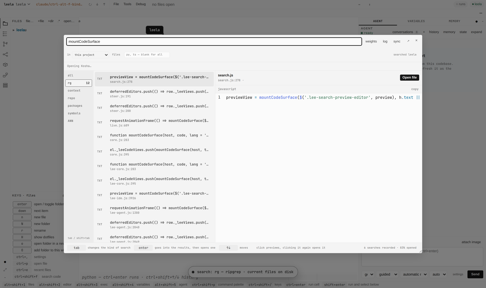
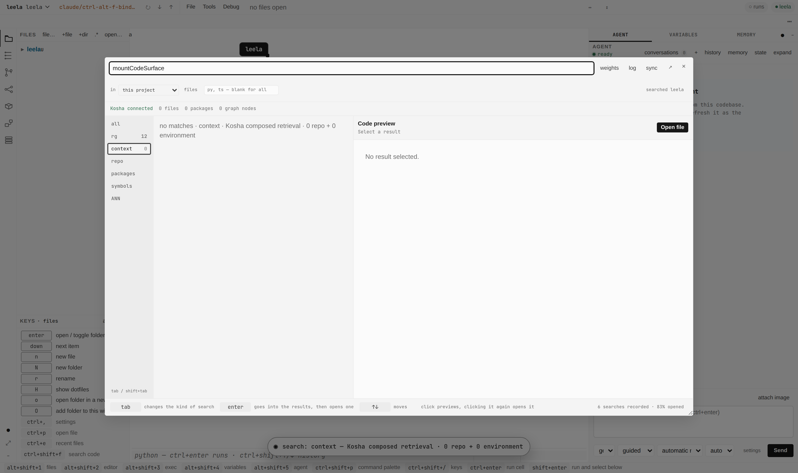
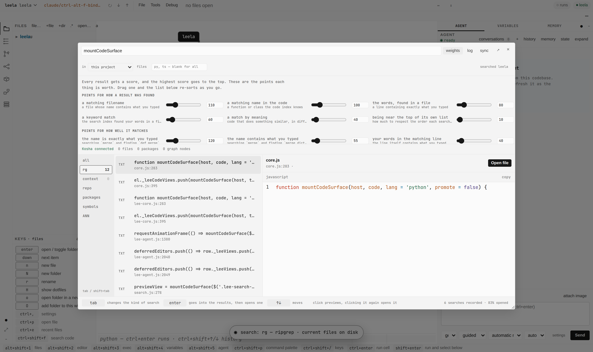
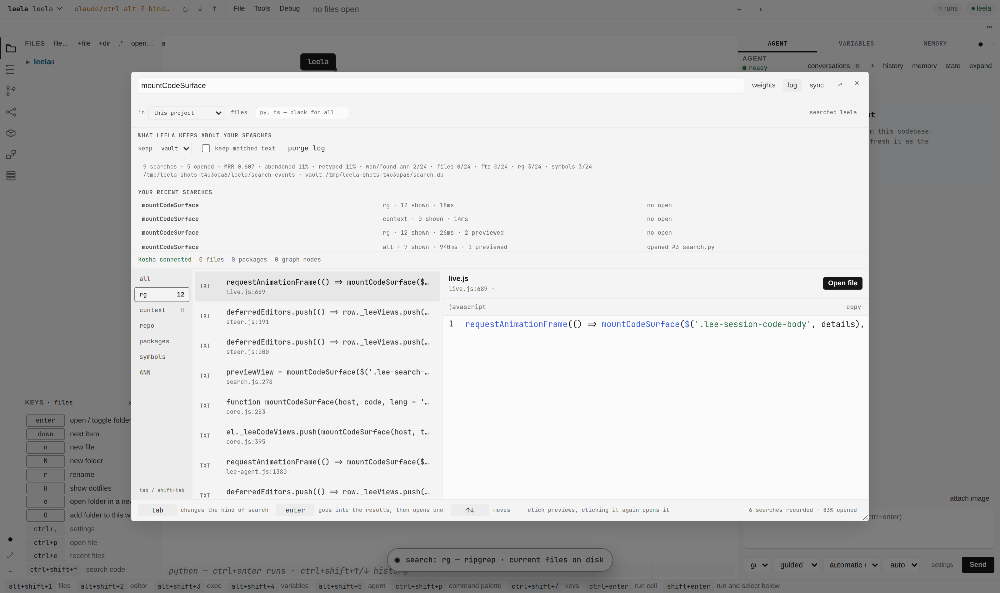

# Code search

`mod+shift+f` opens the code search dialog. One query box, a rail of modes, a result list, and a preview.

## Keys

Focus stays in the query box for the whole session. The current result is expressed with `aria-activedescendant` and a `sel` class, never by moving focus into the list.

| key | what it does |
|---|---|
| `tab` / `shift+tab` | move along the mode rail, switching to each mode as it arrives |
| `enter` on the rail | step into the results |
| `enter` in the results | open the selected hit |
| `up` / `down` | move the selection through the results |
| click | select and preview |
| click the previewing row | open it |
| `esc` | close |

Tab switches the mode rather than marking a pending choice, so the mode on the rail is always the mode that answered. The search each switch fires is debounced.

Before this, the modal's focus trap handled `Tab` before the dialog's own key handler ran. The dialog's `Tab` branch was unreachable, `Tab` walked DOM focus through the rail buttons and every result row, and `Enter` cancelled the focused button's activation without switching anything. `modal()` now runs `onKey` first and skips the trap when the dialog prevents the default.

## Ranking

`all` scores every hit as `sum(weight * feature)`. `Search.features` returns the feature vector and `Weights.score` pays for it. Each hit carries its own vector in `why`, so the client re-ranks locally without a second request.

The features are: which leg found the hit, whether the symbol name is exactly the query, whether it contains the query, whether the query is in the matched line, whether it is in the filename, the hit's place in its own leg's ordering, and whether the path is generated or vendored.

`leg_rank` is `1/(1 + rank)` over the order a leg returned. The raw scores are pagerank, FTS rank and cosine distance, which are not comparable across legs, so the leg's own ordering is used and its scale is not.

`weights` opens the panel. Every weight is a slider, the list re-sorts as one is dragged, and `save weights` writes them to the `search` settings section, layered like every other setting.

`demoteNoise` takes points off `node_modules`, `dist`, `build`, `vendor`, `third_party` and minified files. It defaults to 25. Nought means no opinion. Test directories are not demoted.

## What is recorded

`log` opens the record: every search, the mode it ran in, how many results it showed, how long it took, how many were previewed, and which rank was opened. Clicking a row runs that search again.

Two stores, because one cannot serve both readers.

The event log is the exact record, one JSONL file per day under `<config>/search-events`, pruned to 90 days. `Signals.summary` fits the metrics from it: reciprocal rank of the opened hit, success at 1, 3 and 10, which leg earned each open, per-leg latency, and the abandon and refine rates. These are the numbers the weights answer to.

The vault holds one document per search session, in a vishalakshi file of its own at `$LEELA_SEARCH_VAULT`, else `~/.vishalakshi/search.db`. It is attached to the vault registry as `search` on the first write, with read access and no agent write. One document per session, not per keystroke: a vault embeds and chunks what it stores, and per-event writes would fill it with near-identical fragments.

`search.telemetry` selects `off`, `local` (the event log only) or `vault` (both). It defaults to `vault`. `search.snippets` decides whether the matched text is kept; it defaults to off, so a query and a hit's location are stored but the code around it is not. `purge log` deletes every event file and leaves the vault documents alone. Nothing is sent anywhere.

The event fields are whitelisted in `signals.FIELDS`. A field the client sends that is not in that list is dropped rather than stored, so a later client cannot quietly widen what is kept.

## Screenshots

`python tools/searchshots.py` seeds an event log in a temporary config dir, boots the app against this repository, and writes `docs/screenshots/search-*.png`.
