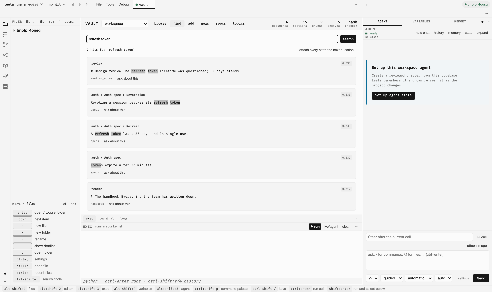
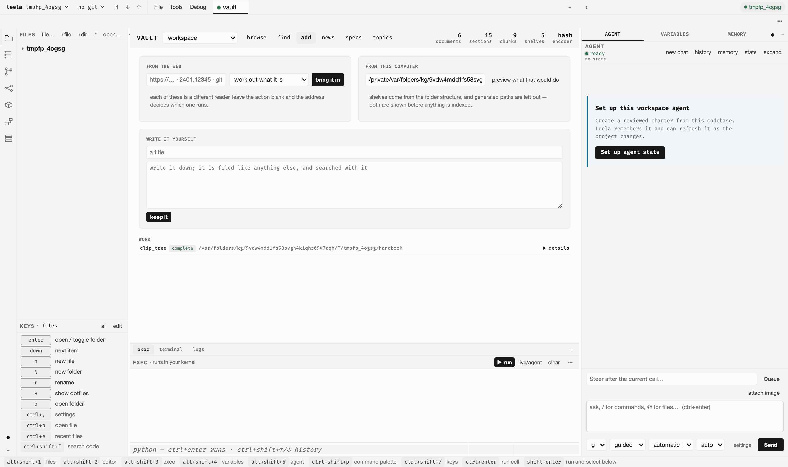

# Vault

Leela stores research, pages, notes, feeds, API specifications, and clipped files in vishalakshi.

Tools > Vault opens one `vaultwb` editor tab.

| view | purpose |
|---|---|
| browse | shelves and documents |
| find | section search |
| add | pages, folders, and notes |
| news | feeds |
| specs | API specifications |
| topics | entity graph topics |

Paste a URL, arXiv id, repository, YouTube URL, file path, or note. `detect` selects the reader. Folder imports show shelves, categories, and excluded generated paths before indexing.

`@` completes vault documents. Document rows and search results attach sections to agent questions. Section attachments include only the selected text.

RSS and Atom items go to the `news` shelf. A source URL may resolve through its alternate-feed link. Item links prevent duplicate imports. Each item keeps the feed's own summary in `meta`. The page prints that standfirst per story and reads no documents to do it.

Following a source reads it once. The cadence governs later reads. Each source carries its own read button. The front page narrows by source and by headline.

The memory tools read the main shelf. Feed items sit on `news`. The agent gets its own: `news_latest`, `news_story`, `news_feeds`, `news_refresh`, `news_follow`, `news_unfollow`. The three that write go in front of the user.

The specs view takes API keys, one header per line, and keeps them where leela keeps its secrets. Each key travels only with calls to the spec it belongs to. Two bundled examples load on a click: Azure retail prices and ECB exchange rates. Neither wants a key, and each arrives with a call already written out.

Loading a spec puts it on the workspace, which is where the agent's tools read it from. One copy, two readers: the page and `api_ops` list the same operations. Each row in the table has its operation name as a button. Press it and the call form below fills in. Add parameters as a JSON object, press call, and the response comes back under the form. That is a real response, sent from here with whatever headers sit beside the spec.

A header value may name an environment variable instead. Write `Authorization: Bearer ${COSTING_TOKEN}`. Leela stores the reference. The secret stays in the environment, and rotating the variable rotates the credential. The panel says which variables this machine sets and which it does not. A name with nothing behind it refuses the call. A literal `${...}` sent as a key comes back as a bare 401.

Each spec is `cloud` or `local`. A local-only spec refuses a call from a hosted model and sends nothing. The refusal names both ways out. It refuses rather than reroutes. Switching models in the middle of a turn would hand the same numbers to the hosted model that had already read the question. The gate sits on `api_call`, which the agent reaches. The page calls `api_fetch`. The person reading the response owns the data in it.

The briefing names the specs this session holds: operation counts, groups, the headers each sends, its reach. The agent then leaves alone a spec the page loaded a minute ago, and a spec that arrives during a turn is in the next briefing. Header names and variable names only. A value never reaches the model. An unauthenticated 401 becomes something the agent explains rather than retries.

Use notebooks and the live kernel for table analysis. PII reports appear on document rows and tidy candidates.
